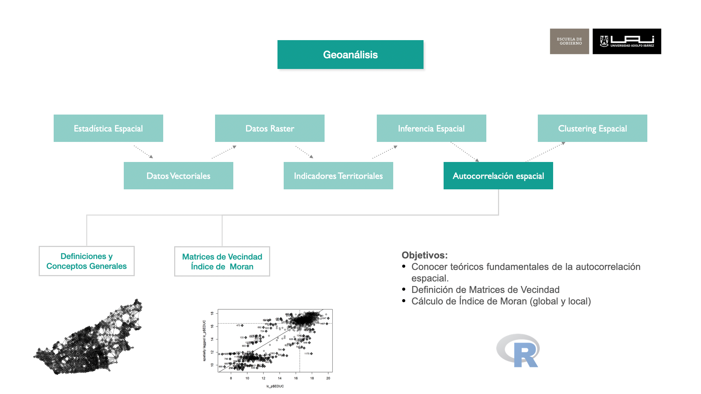

```{r setup, include=FALSE}
knitr::opts_chunk$set(echo = TRUE)
suppressPackageStartupMessages(library(dplyr))
suppressPackageStartupMessages(library(sf))
suppressPackageStartupMessages(library(ggplot2))
suppressPackageStartupMessages(library(spdep))
```

## Objetivos de aprendizaje



-   Distinguir autocorrelación positiva, negativa y ausencia de un patrón detectable.
-   Construir e interpretar vecinos y pesos espaciales.
-   Interpretar el índice de Moran global, su prueba y su diagrama de dispersión.
-   Localizar agrupamientos y valores atípicos con Moran local, reconociendo sus límites.
-   Evaluar cómo cambian los resultados al modificar la reciprocidad y la ponderación de los vecinos.

## Conceptos generales de autocorrelación espacial

### Introducción

Imaginemos que caminamos por una ciudad cualquiera. Notamos que en ciertas zonas, las viviendas tienen características similares: el tamaño de las casas, el tipo de construcciones, el acceso a servicios como parques, centros comerciales, o el estado de las calles. En un barrio de alto nivel socioeconómico, es más probable que las viviendas tengan características como jardines amplios, buena iluminación pública y servicios de calidad. En cambio, en otras zonas con un nivel socioeconómico más bajo, podríamos observar otro tipo de infraestructura, menos servicios públicos y tal vez menos opciones de transporte.

Podríamos preguntarnos si esos rasgos se agrupan espacialmente. La **autocorrelación espacial** describe la relación entre el valor de una variable en un lugar y los valores de **esa misma variable** en lugares definidos como vecinos. Si valores semejantes tienden a estar próximos, la autocorrelación es positiva; si los vecinos tienden a mostrar valores opuestos, es negativa. No detectar una de estas tendencias con la vecindad elegida no demuestra independencia entre las observaciones.

Encontrar una concentración no explica por sí solo cómo se produjo. La distribución de servicios, el mercado de vivienda y la historia urbana pueden intervenir, pero se necesitan otros datos para evaluar esas explicaciones. Un mapa de autocorrelación ayuda a formular preguntas sobre el territorio; por sí solo no demuestra una causa ni determina una intervención pública.

### ¿Para qué sirve?

La autocorrelación ayuda a examinar si una característica se distribuye de manera agrupada. Su utilidad depende de la variable, la escala y la pregunta. Por ejemplo:

-   **Políticas públicas**: Un agrupamiento de baja cobertura de servicios puede señalar dónde examinar necesidades, distancias y capacidad instalada antes de tomar decisiones.

-   **Salud pública**: Las tasas de enfermedad pueden presentar agrupamientos, aunque las diferencias de población, acceso al diagnóstico y calidad del registro también deben examinarse. Un patrón espacial no prueba transmisión entre lugares.

-   **Seguridad**: Una concentración de denuncias puede motivar una investigación localizada; también puede reflejar diferencias en fiscalización o disposición a denunciar.

-   **Ambiente**: La concentración de contaminantes puede ayudar a priorizar mediciones adicionales y estudiar fuentes posibles.

### ¿Cómo se mide?

**Índice I de Moran**

El índice I de Moran resume la asociación entre los valores de una variable y los valores de esa misma variable en los lugares vecinos. Fue propuesto por @moran_interpretation_1948 y desarrollado en la literatura de estadística espacial por @Cliff_1972. Distinguiremos una medida **global**, para todo el mapa, y una **local**, para cada unidad territorial.

Estudiaremos unidades censales urbanas de Las Condes mediante `IEA`, el **Índice de Escolaridad Adulta** construido en el capítulo de [indicadores territoriales](indicadores_territoriales.qmd). Corresponde al promedio de escolaridad de la población de 18 años o más (`prom_escolaridad18`) en las unidades con población. Es un indicador derivado para el curso, no un índice oficial del INE. La escolaridad es una aproximación parcial a diferencias socioeconómicas: no mide directamente ingresos y la autocorrelación de promedios territoriales no basta para afirmar segregación residencial entre personas.

Seguiremos esta secuencia: preparar los datos, definir ocho vecinos recíprocos con igual peso, interpretar Moran global y local, y finalmente cambiar **una decisión de la matriz de pesos a la vez** para examinar la sensibilidad de los resultados.

## Preparación de datos

**Cargar Librerías**

```{r eval=FALSE}
library(dplyr)
library(sf)
library(ggplot2)
library(spdep)
```

**Lectura de unidades censales**

Leemos la base derivada del Censo 2024 y seleccionamos Las Condes. `IEA` resume escolaridad adulta y `n_per` es la población total de cada unidad censal. Esta última se utilizará después para ponderar a los vecinos. El archivo de resultados está en `data/results/`.

```{r}
ruta_manzanas <- "data/results/R13_Santiago_urbano_ind_socioeconomicos_2024.rds"
mi_comuna <- "LAS CONDES"
mz_comuna <- readRDS(ruta_manzanas) %>%
  filter(COMUNA == mi_comuna) %>%
  st_transform(32719)
n_original <- nrow(mz_comuna)
```

**Excluir unidades sin dato de escolaridad**

Para que datos y vecinos tengan la misma cantidad de unidades, retiramos los valores faltantes de `IEA` **antes** de construir la vecindad. Conservamos unidades con `n_per > 0` para poder asignar pesos por población. En esta base, las unidades con `IEA` definido tienen población positiva; no debemos suponer que siempre ocurrirá en otras bases. Conviene contar las exclusiones y revisar si se concentran en algún sector. EPSG:32719 permite trabajar con coordenadas proyectadas en metros.

```{r}

mz_comuna <- mz_comuna %>%
  filter(is.finite(IEA), is.finite(n_per), n_per > 0)
tibble(unidades_originales = n_original,
       unidades_analizadas = nrow(mz_comuna),
       unidades_excluidas = n_original - nrow(mz_comuna))
```

**Mapa del indicador de escolaridad**

```{r}
ggplot(mz_comuna) +
  geom_sf(aes(fill = IEA), color = "gray80", linewidth = 0.1) +
  scale_fill_distiller(palette = "YlGnBu", direction = 1,
                       name = "IEA (años)") +
  labs(title = "Escolaridad adulta por unidad censal",
       subtitle = "Las Condes · Censo 2024 · personas de 18 años o más") +
  theme_minimal()
```

**Antes de interpretar el mapa:** observa la distribución del indicador y sus valores extremos. Los promedios de unidades con pocos adultos pueden ser inestables. Una unidad grande tampoco representa necesariamente a más personas que una pequeña.

## Construcción de la matriz de vecindad {#sec-matrizVec}

Una matriz de vecindad indica qué pares de unidades consideramos conectados. Para $n$ manzanas, la matriz binaria $B=(b_{ij})$ tiene una fila y una columna por manzana:

$$
b_{ij}=\begin{cases}
1 & \text{si }j\text{ es vecina de }i,\\
0 & \text{en otro caso.}
\end{cases}
$$

La diagonal suele ser cero: una manzana no es vecina de sí misma. Por ejemplo, si la manzana 1 se conecta con 2 y 3, y estas últimas solo con 1, obtenemos:

$$
B=\begin{pmatrix}
0&1&1\\
1&0&0\\
1&0&0
\end{pmatrix}.
$$

Esta matriz es simétrica porque cada relación es recíproca. **No todas las definiciones de vecindad producen una matriz simétrica.** Si $j$ está entre los $k$ vecinos más cercanos de $i$, no necesariamente ocurre lo mismo a la inversa.

Podemos definir vecinos por contigüidad de polígonos (*reina* si comparten borde o vértice; *torre* si comparten borde), por una distancia máxima o por los $k$ puntos más cercanos. La elección debe representar el proceso estudiado. Dos manzanas pueden estar próximas en línea recta y separadas por una autopista o un cerro.

Por ejemplo, para estudiar servicios accesibles caminando, una distancia o tiempo de viaje por la red peatonal puede ser más pertinente que la cercanía entre puntos interiores. Para examinar una posible relación entre manzanas colindantes, puede ser más natural partir por contigüidad. La definición se elige según la pregunta de política pública y luego se contrasta con alternativas razonables.

### Ocho vecinos más cercanos

Representamos cada manzana con un punto interior y buscamos sus ocho puntos más cercanos. En el sistema proyectado EPSG:32719, las distancias se expresan en metros. El número **8 es una decisión de análisis**, no una propiedad natural de las manzanas. Con `sym = TRUE` agregamos la relación inversa cuando hace falta: así, cada manzana tendrá **al menos** ocho vecinos y la matriz binaria será simétrica.

```{r}
puntos <- st_point_on_surface(st_geometry(mz_comuna))
coordenadas <- st_coordinates(puntos)
k <- 8
# knearneigh: encuentra los k puntos más cercanos a cada manzana.
cercanos <- knearneigh(coordenadas, k = k)
# knn2nb: convierte ese resultado en una lista de vecinos; sym agrega reciprocidad.
vecinos <- knn2nb(cercanos, sym = TRUE)

# card: cuenta cuántos vecinos tiene cada manzana.
c(minimo = min(card(vecinos)), mediana = median(card(vecinos)),
  maximo = max(card(vecinos)))
```

`card(vecinos)` cuenta cuántos vecinos tiene cada manzana. Aunque buscamos ocho para cada una, `sym = TRUE` añade relaciones recíprocas: si la manzana A eligió a B, B también contará a A. Por eso el mínimo es ocho, pero la mediana y el máximo pueden ser mayores. Con `sym = FALSE` cada manzana tendría exactamente ocho vecinos, aunque A podría considerar vecina a B sin que ocurriera lo mismo a la inversa. Esa dirección resulta del algoritmo y **no representa por sí sola un flujo real** entre manzanas.

Usaremos esta vecindad recíproca y pesos iguales durante todo el análisis principal. Al final calcularemos el caso no recíproco para ver qué cambia. Además, aun cuando la matriz binaria de vecinos sea simétrica, los pesos estandarizados por filas pueden no serlo si las unidades tienen distinto número de vecinos.

```{r}
# nb2lines: dibuja una línea por cada relación de vecindad.
lineas_vecinos <- st_as_sf(nb2lines(vecinos, coords = coordenadas))
st_crs(lineas_vecinos) <- st_crs(mz_comuna)
ggplot() +
  geom_sf(data = mz_comuna, fill = NA, color = "gray70", linewidth = 0.1) +
  geom_sf(data = lineas_vecinos, color = "#c0392b", alpha = 0.25,
          linewidth = 0.2) +
  geom_sf(data = puntos, color = "#34495e", size = 0.2) +
  labs(title = "Relaciones entre puntos representativos de las manzanas",
       subtitle = "Ocho vecinos más cercanos, con relaciones recíprocas") +
  theme_void()
```

Una matriz de tamaño $n\times n$ puede ocupar mucha memoria. Para aprender a leerla mostramos solo un bloque pequeño; `vecinos` almacena las conexiones de forma más compacta.

```{r}
# nb2listw: asigna peso 1 a cada vecino (matriz binaria).
pesos_binarios <- nb2listw(vecinos, style = "B")
# listw2mat: muestra esos pesos como una matriz de filas y columnas.
matriz_binaria <- listw2mat(pesos_binarios)
matriz_binaria[1:6, 1:6]
```

Un cero dentro de ese bloque **no significa** que la fila no tenga vecinos: puede estar conectada con columnas que no se muestran. La matriz binaria indica conexiones; para calcular promedios de vecinos asignamos **pesos**.

### De vecinos a pesos

En este ejercicio cada vecino de $i$ recibe el mismo peso y la suma de cada fila es uno:

$$w_{ij}=\frac{b_{ij}}{\sum_j b_{ij}}$$.

A esto se le llama **estandarización por filas**. Si una manzana tiene ocho vecinos, cada uno recibe peso $1/8$; si tiene diez, cada uno recibe $1/10$. Aunque $B$ sea simétrica, la matriz de pesos $W=(w_{ij})$ puede dejar de serlo porque las manzanas pueden tener distinta cantidad de vecinos.

```{r}
# nb2listw: reparte el peso de cada manzana entre sus vecinos (filas suman 1).
pesos <- nb2listw(vecinos, style = "W")
# listw2mat: convierte la lista de pesos en una matriz para inspeccionarla.
matriz_pesos <- listw2mat(pesos)
round(matriz_pesos[1:6, 1:6], 3)
range(rowSums(matriz_pesos))
```

La **media espacial** o *rezago espacial* de una variable $x$ en la unidad $i$ es $\sum_j w_{ij}x_j$: con estos pesos, corresponde al promedio de los valores de sus vecinos. Esta matriz, construida con relaciones recíprocas y peso igual por vecino, será nuestra **referencia** para estudiar Moran global y local.

## Índice de Moran global {#sec-globalMoran}

El índice global resume si, **en el conjunto de manzanas**, los valores de un indicador tienden a parecerse a los de sus vecinos. Sea $x_i$ el valor de la manzana $i$, $z_i=x_i-\bar{x}$ su diferencia respecto de la media y $S_0=\sum_i\sum_j w_{ij}$ la suma de todos los pesos:

$$
I=\frac{n}{S_0}\,
  \frac{\sum_{i=1}^{n}\sum_{j=1}^{n}w_{ij}z_i z_j}
       {\sum_{i=1}^{n}z_i^2}.
$$ {#eq-moran-test}

Con filas estandarizadas y sin manzanas aisladas, $S_0=n$. Un $I$ positivo sugiere semejanza entre vecinos; uno negativo, contraste. Un valor cercano al esperado bajo la hipótesis nula no aporta evidencia clara de ninguno de esos patrones. **Moran I no está, en general, acotado siempre entre $-1$ y $1$**: sus límites dependen de los pesos. Tampoco conviene interpretar su magnitud sin considerar la matriz utilizada.

**Cómo leer los términos de la ecuación:**

| Símbolo | Significado en este ejercicio |
|:--|:--|
| $n$; $i$ y $j$ | $n$ es el número de manzanas. $i$ identifica la manzana que analizamos y $j$ recorre las demás manzanas. |
| $x_i$ y $\bar{x}$ | $x_i$ es el `IEA` de la manzana $i$ (años promedio de escolaridad adulta); $\bar{x}$ es la media del `IEA` de todas las manzanas analizadas. |
| $z_i=x_i-\bar{x}$ | Diferencia entre el `IEA` de $i$ y la media: positiva si está sobre la media y negativa si está bajo ella. $z_j$ es la misma diferencia para $j$. |
| $w_{ij}$ | Peso que la matriz asigna a $j$ como vecino de $i$; vale cero si no son vecinos. Aquí los vecinos de una manzana comparten el peso por igual y $\sum_j w_{ij}=1$. |
| $S_0=\sum_i\sum_j w_{ij}$ | Suma de todos los pesos de la matriz. Aquí equivale a $n$, por lo que el factor $n/S_0$ vale 1. |

La suma $\sum_j w_{ij}z_j$ es el **promedio ponderado de las diferencias de los vecinos respecto de la media general**; lo llamaremos *rezago espacial* de $i$. El numerador suma, para todas las manzanas, el producto entre su diferencia $z_i$ y ese rezago: productos positivos aportan asociación de valores semejantes; productos negativos, contraste. El denominador $\sum_i z_i^2$ mide la variación total del `IEA` respecto de su media y permite expresar $I$ sin unidades de años. Las dos sumas del numerador recorren las manzanas $i$ y, para cada una, sus posibles vecinos $j$.

**Ejemplo pequeño.** Imagina cuatro zonas ordenadas en una línea, con valores $(1,1,3,3)$. Su media es 2 y los valores centrados son $(-1,-1,1,1)$. Si cada zona se conecta solo con las contiguas y los pesos se estandarizan por filas, los rezagos son $(-1,0,0,1)$. Los productos entre cada valor centrado y su rezago suman 2; los cuadrados de los valores centrados suman 4. Por tanto, $I=2/4=0{,}5$: hay asociación positiva en este ejemplo. Este cálculo descriptivo no proporciona un valor $p$.

### Prueba de hipótesis

La hipótesis nula de **aleatoriedad espacial** plantea que los valores observados podrían haberse asignado a las manzanas sin producir un patrón excepcional con la vecindad elegida. Una prueba por permutaciones compara el $I$ observado con índices obtenidos al reasignar aleatoriamente los valores entre manzanas. La alternativa `greater` busca autocorrelación **positiva**; para una pregunta sobre autocorrelación negativa se usaría `less`, y para cualquiera de las dos direcciones, `two.sided`.

```{r}
set.seed(2026)
# moran.mc: calcula Moran global y su valor p con 999 permutaciones.
prueba_global <- moran.mc(mz_comuna$IEA, listw = pesos,
                          nsim = 999, alternative = "greater")
prueba_global
```

### Cómo leer el resultado de `moran.mc()`

La salida resume una prueba para las **`r nrow(mz_comuna)` unidades analizadas de Las Condes**. Cada línea responde una pregunta distinta:

| Parte de la salida | Lectura en este ejercicio |
|:--|:--|
| `data: mz_comuna$IEA` | Variable estudiada: promedio de escolaridad de personas de 18 años o más. |
| `weights: pesos` | Ocho vecinos iniciales, relaciones recíprocas y el mismo peso para cada vecino de una unidad. |
| `number of simulations + 1: 1000` | Se calculó Moran I para 999 reasignaciones aleatorias del `IEA` y se añadió el valor observado. |
| `statistic = 0.7333` | Moran I observado. Es **positivo**: los valores altos tienden a estar cerca de valores altos y los bajos, cerca de valores bajos, según estos pesos. |
| `observed rank = 1000` | El valor observado fue el **mayor** de los 1.000 valores comparados. Ninguna permutación produjo un I tan alto. |
| `p-value = 0.001` | Con 999 permutaciones, la evidencia contra la aleatoriedad espacial es fuerte en la dirección positiva. |
| `alternative hypothesis: greater` | La prueba busca una asociación **positiva**, es decir, un I mayor que el esperable bajo la hipótesis nula. |

En esta ejecución, el mayor I simulado fue **`r round(max(prueba_global$res[-length(prueba_global$res)]), 3)`**, muy por debajo del observado **`r round(as.numeric(prueba_global$statistic), 3)`**. Para la alternativa `greater`, el valor $p$ de Monte Carlo se calcula así:

$$
p=\frac{1+\text{número de simulaciones con }I_{sim}\geq I_{obs}}{999+1}
 =\frac{1+0}{1000}=0{,}001.
$$

Este es el **menor valor $p$ que puede obtenerse con 999 permutaciones**; aumentar `nsim` permitiría estimar con más detalle una probabilidad muy pequeña. No debe leerse como probabilidad cero de observar otro resultado.

Fijamos el nivel de significancia en $0{,}05$. Como $0{,}001 \leq 0{,}05$, **rechazamos la hipótesis nula de aleatoriedad espacial** a favor de una asociación positiva del `IEA` en este conjunto de unidades. El resultado no significa que la hipótesis nula tenga una probabilidad de $0{,}1\,\%$ de ser verdadera. Tampoco significa que el **73,33 %** de la escolaridad se explique por la ubicación: Moran I no es un porcentaje. Su magnitud depende del indicador, del territorio y de la matriz de pesos, por lo que no conviene compararla sin mantener claras esas decisiones.

El índice **global** resume el conjunto: no afirma que cada unidad esté agrupada ni muestra dónde están las concentraciones. Para localizar asociaciones HH o LL necesitamos el análisis local de la sección siguiente. La [documentación de `spdep::moran.mc()`](https://r-spatial.github.io/spdep/reference/moran.mc.html) describe el rango observado y el valor $p$ de esta prueba por permutaciones.

::: {.callout-tip title="¿Cómo podría informar una política pública?"}
- **Educación de personas adultas:** el resultado global sugiere que la escolaridad adulta sigue un patrón espacial que merece examinarse. Si el análisis local identifica sectores LL, es decir, bajos **respecto de la media de las unidades analizadas**, un municipio podría revisar allí la cantidad de adultos, los niveles absolutos de escolaridad y la oferta de cursos antes de decidir dónde ofrecer programas vespertinos o apoyo territorial.
- **Acceso a capacitación:** se puede contrastar el mapa de escolaridad adulta con la ubicación de centros de formación y los tiempos de viaje. Si aparecen sectores con escolaridad relativamente baja y escaso acceso, esa combinación puede orientar una investigación y el diseño de alternativas de atención.

Estas son **preguntas para investigar**, no decisiones que se desprendan automáticamente de Moran I. El índice global no identifica sectores prioritarios, no mide la demanda de cursos y no demuestra que la falta de servicios haya causado la escolaridad observada.
:::

### Diagrama de dispersión de Moran

**Cada punto representa una manzana.** Su posición horizontal muestra cuántas desviaciones estándar está su `IEA` por encima o por debajo de la media de las manzanas estudiadas. Su posición vertical muestra el **promedio ponderado de esos valores estandarizados entre sus vecinos** (el *rezago espacial*). Como los pesos de cada fila suman uno, un valor vertical positivo indica que el promedio vecinal del `IEA` está sobre la media del área estudiada; uno negativo indica que está bajo ella.

En las ecuaciones, $z_i$ es la diferencia en años respecto de la media. Para dibujar el diagrama dividimos esa diferencia por la desviación estándar mediante `scale()`: así los ejes se leen en desviaciones estándar. Esta conversión no cambia los signos, los cuadrantes ni el índice de Moran.

Las líneas en **cero** dividen el gráfico: a la derecha están las manzanas con `IEA` sobre la media; a la izquierda, las que están bajo ella. Arriba están las que tienen un promedio vecinal sobre la media; abajo, las que tienen uno bajo la media. La **primera letra** del cuadrante describe la manzana y la **segunda**, su entorno: `H` significa alto y `L`, bajo **en relación con la media del área**, no con un umbral absoluto de escolaridad.

Para leer las cuatro posibilidades, imaginemos una media de **15 años** de escolaridad adulta. Las cifras de la tabla son ilustrativas:

| Cuadrante y posición | `IEA` de la manzana | Promedio vecinal | ¿Qué muestra? |
|:--|:--|:--|:--|
| **HH**, arriba a la derecha | 17 años: alto | 16 años: alto | Una manzana de escolaridad relativamente alta entre vecinos que, en promedio, también tienen escolaridad alta. |
| **LL**, abajo a la izquierda | 13 años: bajo | 14 años: bajo | Una manzana de escolaridad relativamente baja entre vecinos que, en promedio, también tienen escolaridad baja. |
| **HL**, abajo a la derecha | 17 años: alto | 14 años: bajo | Una manzana de escolaridad alta que **contrasta** con su entorno de promedio bajo. |
| **LH**, arriba a la izquierda | 13 años: bajo | 16 años: alto | Una manzana de escolaridad baja que **contrasta** con su entorno de promedio alto. |

En una analogía con ventas de viviendas, **HL** sería una casa cara frente a un precio promedio bajo de las casas cercanas; **LH**, una casa barata en un entorno de precios promedio altos. «Barrio de precios altos» describe precios, no calidad del barrio. En este capítulo analizamos **promedios de escolaridad adulta por manzana**, no personas ni viviendas individuales.

Los puntos HH y LL indican **semejanza** entre la manzana y su entorno; HL y LH indican **contraste**. Un punto en cualquiera de estos cuadrantes **no es automáticamente significativo**: el diagrama clasifica posiciones, mientras que la prueba local y el umbral $p \leq 0{,}05$ ayudan a decidir qué asociaciones destacar estadísticamente.

```{r}
dispersion <- tibble(
  z_i = as.numeric(scale(mz_comuna$IEA)),
  # lag.listw: calcula para cada manzana el promedio ponderado de sus vecinos.
  rezago = lag.listw(pesos, z_i)
)

ggplot(dispersion, aes(z_i, rezago)) +
  geom_hline(yintercept = 0, color = "gray55") +
  geom_vline(xintercept = 0, color = "gray55") +
  geom_point(alpha = 0.35, size = 0.8) +
  geom_smooth(method = "lm", se = FALSE, color = "#c0392b") +
  annotate("label", x = -Inf, y = Inf, label = "LH: bajo / alto",
           hjust = -0.05, vjust = 1.2, size = 3) +
  annotate("label", x = Inf, y = Inf, label = "HH: alto / alto",
           hjust = 1.05, vjust = 1.2, size = 3) +
  annotate("label", x = -Inf, y = -Inf, label = "LL: bajo / bajo",
           hjust = -0.05, vjust = -0.2, size = 3) +
  annotate("label", x = Inf, y = -Inf, label = "HL: alto / bajo",
           hjust = 1.05, vjust = -0.2, size = 3) +
  labs(x = "Escolaridad estandarizada de la manzana",
       y = "Promedio ponderado de sus vecinos",
       title = "Diagrama de dispersión de Moran") +
  theme_minimal()
```

**¿Qué vemos en este gráfico?** La recta roja asciende: en promedio, una manzana con `IEA` más alto tiende a tener vecinos con `IEA` más alto. También hay puntos HL y LH que se apartan de esa tendencia. Cuando todas las filas de pesos suman uno, la pendiente de la recta corresponde al índice global de Moran. El gráfico resume esa relación, pero no indica por sí solo qué manzanas tienen una asociación local estadísticamente destacada.

## Índice de Moran local {#sec-localMoran}

El índice global resume todo el mapa y no localiza las zonas que contribuyen al patrón. El índice local propuesto por @anselin_local_1995 calcula una contribución para cada manzana:

$$
I_i=\frac{z_i\sum_j w_{ij}z_j}{m_2},
\qquad m_2=\frac{1}{n}\sum_i z_i^2.
$$ {#eq-moran-local}

**Ahora la $i$ importa:** $I_i$ es el índice **de una manzana**, mientras que $I$ resume todas las manzanas. Usamos los mismos $z_i$, $w_{ij}$ y $n$ de la ecuación global. La parte $\sum_j w_{ij}z_j$ es el rezago espacial de $i$: el promedio ponderado de las diferencias de sus vecinos respecto de la media general. Multiplicarlo por $z_i$ muestra si la manzana y su entorno están del **mismo lado** de la media (producto positivo) o de **lados opuestos** (producto negativo). $m_2$ es el promedio de las diferencias al cuadrado de **todas** las manzanas; sirve como escala común para comparar sus $I_i$.

Por ejemplo, si la media fuera 15 años, una manzana con `IEA` de 17 tendría $z_i=+2$. Si sus vecinos promedian 16, el rezago sería $+1$ y el producto $z_i\sum_j w_{ij}z_j$ sería $+2$ (**HH**). Si promedian 14, el rezago sería $-1$ y el producto sería $-2$ (**HL**). Para obtener el valor de $I_i$ todavía hay que dividir ese producto por $m_2$. **El signo de $I_i$ no distingue HH de LL, ni HL de LH**; para eso necesitamos mirar por separado los signos de $z_i$ y de su rezago.

Esta forma corresponde a la escala usada por defecto en `spdep::localmoran()` (`mlvar = TRUE`). Con filas de pesos que suman uno, el promedio de los $I_i$ coincide con el índice global: ambos agregan los productos entre cada manzana y su entorno, pero el global los resume en un solo valor.

```{r}
# localmoran: calcula el índice local y su prueba para cada manzana.
resultado_local <- localmoran(mz_comuna$IEA, listw = pesos,
                              alternative = "two.sided", mlvar = TRUE)
head(resultado_local)
```

`Ii` es el estadístico observado; `E.Ii` y `Var.Ii` son su media y varianza bajo la hipótesis nula elegida por la función. `Z.Ii` estandariza la diferencia entre el valor observado y el esperado. El valor $p$ bilateral se obtiene mediante una **aproximación normal**. Su signo o magnitud no reemplaza la lectura de los cuadrantes.

### ¿Qué significa usar $p \leq 0{,}05$?

`localmoran()` prueba una hipótesis para **cada unidad censal**. La **hipótesis nula** ($H_0$) plantea que su asociación con los vecinos no es más inusual de lo que cabría esperar bajo aleatoriedad espacial, dada la matriz de pesos elegida. El valor $p$ indica qué tan inusual sería el resultado observado **si $H_0$ fuera cierta**. En este capítulo la prueba es bilateral: examina asociaciones locales positivas y negativas.

Elegimos de antemano $0{,}05$ como **nivel de significancia**. Si $p \leq 0{,}05$, **rechazamos $H_0$ para esa unidad** y la marcamos como destacada con este criterio. Si $p > 0{,}05$, **no tenemos evidencia suficiente para rechazarla**; eso no demuestra que no exista un patrón. El umbral del 5 % es una convención de trabajo: para una sola prueba válida, fija en 5 % la tasa de rechazos erróneos a largo plazo cuando $H_0$ es cierta. No significa que haya un 95 % de probabilidad de que nuestra interpretación sea verdadera.

**Ejemplo:** si una unidad y sus vecinos están sobre la media del `IEA` y su $p$ bilateral es $0{,}03$, la clasificamos como **HH**. Si sus valores también están sobre la media pero $p=0{,}08$, queda como «No destacado» con este umbral. Los signos de la unidad y su rezago determinan el cuadrante; el valor $p$ determina si lo destacamos estadísticamente.

Usaremos **$p \leq 0{,}05$ sin ajuste** para explorar el mapa y comparar matrices. Como examinamos muchas unidades a la vez, algunas pueden quedar destacadas por azar. Por eso el mapa señala lugares que conviene estudiar, no una lista definitiva para tomar decisiones públicas.

```{r}
p_local <- resultado_local[seq_len(nrow(resultado_local)), "Pr(z != E(Ii))"]

mzs_cluster <- mz_comuna %>%
  mutate(
    z_i = dispersion$z_i,
    rezago = dispersion$rezago,
    I_local = resultado_local[seq_len(nrow(resultado_local)), "Ii"],
    p_valor = p_local,
    cluster = case_when(
      p_valor <= 0.05 & z_i > 0 & rezago > 0 ~ "HH",
      p_valor <= 0.05 & z_i < 0 & rezago < 0 ~ "LL",
      p_valor <= 0.05 & z_i > 0 & rezago < 0 ~ "HL",
      p_valor <= 0.05 & z_i < 0 & rezago > 0 ~ "LH",
      TRUE ~ "No destacado"
    )
  )

table(mzs_cluster$cluster)
```

Si alguna categoría no aparece en la tabla, ninguna manzana cumplió **a la vez** su cuadrante y el filtro de significancia aplicado. Eso no significa que dicho cuadrante esté vacío en el diagrama de dispersión.

HH y LL indican **asociación local** de valores relativamente altos o bajos; se suelen llamar agrupamientos locales. HL y LH son **valores atípicos espaciales**: la manzana contrasta con su entorno. «No destacado» significa que este procedimiento no aportó suficiente evidencia local al umbral elegido; no significa que el valor de la manzana sea normal, que no exista relación espacial o que la zona carezca de importancia para la política pública.

```{r}
colores_cluster <- c(
  "HH" = "#b2182b", "LL" = "#2166ac",
  "HL" = "#ef8a62", "LH" = "#67a9cf",
  "No destacado" = "#e0e0e0"
)

ggplot(mzs_cluster) +
  geom_sf(aes(fill = cluster), color = "white", linewidth = 0.05) +
  scale_fill_manual(values = colores_cluster, drop = FALSE,
                    name = "Asociación local") +
  labs(title = "Asociación espacial local del IEA",
       subtitle = "Prueba bilateral; p ≤ 0,05 sin ajuste") +
  theme_void()
```

Algunas manzanas **HH** se ven aisladas en rojo. La etiqueta indica que su `IEA` y el **promedio de sus vecinos** están sobre la media y que la prueba local de esa manzana cumple $p \leq 0{,}05$; los vecinos pueden aparecer grises si no cumplen su propia prueba. Además, aquí la vecindad se definió por **puntos cercanos**, por lo que los vecinos del cálculo no siempre son los polígonos que se tocan en el mapa. Así, **HH expresa una asociación local, sin exigir una mancha continua de manzanas rojas**.

::: {.callout-note title="Cuando se examinan muchas manzanas"}
Con muchas pruebas locales, algunos valores $p \leq 0{,}05$ pueden aparecer por azar. El criterio **sin ajuste** que usamos aquí sirve para explorar el mapa y aprender a interpretarlo. Si después de revisar cientos de manzanas se quiere presentar un conjunto de sectores como hallazgos estadísticos, conviene considerar métodos para **comparaciones múltiples**. Uno es Benjamini–Hochberg (BH), que busca limitar, bajo sus supuestos, la proporción esperada de falsos hallazgos entre los sectores destacados. Al aplicar BH, pueden quedar menos manzanas destacadas; el ajuste no corrige posibles problemas en los datos ni en la definición de vecinos. La [guía de GeoDa sobre Moran local](https://geodacenter.github.io/workbook/6a_local_auto/lab6a.html) amplía este tema.
:::

El mapa depende de la variable, del área de estudio, de $k=8$, del criterio de reciprocidad y del método de inferencia. Para un análisis aplicado, conviene repetirlo con otra vecindad defendible y comparar los resultados. También se puede contrastar la aproximación normal de `localmoran()` con permutaciones condicionales mediante `spdep::localmoran_perm()`; las clasificaciones pueden cambiar cerca del umbral de significancia.

## Sensibilidad a la estructura y los pesos de la matriz

El análisis anterior usó **ocho vecinos iniciales, relaciones recíprocas y peso igual**. Ahora mantendremos las mismas unidades y el mismo `IEA`, pero cambiaremos por separado una decisión de la matriz. Compararemos cuatro escenarios:

| Escenario | Conexiones entre unidades | Peso de cada vecino |
|:--|:--|:--|
| Referencia | Recíprocas | Igual dentro de cada fila |
| Sin reciprocidad | Ocho vecinos elegidos por cada unidad | Igual dentro de cada fila |
| Por población | Las mismas conexiones recíprocas | Proporcional a `n_per` del vecino |
| Por distancia | Las mismas conexiones recíprocas | Inverso a la distancia al vecino |

Los dos últimos escenarios **conservan quiénes son vecinos**; solo alteran cuánto contribuye cada uno. El escenario sin reciprocidad cambia **qué pares están conectados**. En todos los casos normalizamos cada fila a suma uno. Esto facilita comparar los rezagos, pero no vuelve simétrica a la matriz de pesos $W$.

### Cambiar la reciprocidad

Volvemos al mismo resultado de `knearneigh()`, ahora con `sym = FALSE`. Cada unidad conserva exactamente ocho vecinos salientes. Puede ocurrir que $i$ elija a $j$ y $j$ no elija a $i$; se trata de una decisión del algoritmo de cercanía, no de un flujo observado entre territorios.

```{r}
# knn2nb: conserva las ocho elecciones originales sin agregar vínculos inversos.
vecinos_no_reciprocos <- knn2nb(cercanos, sym = FALSE)
# nb2listw: reparte el peso por igual entre los ocho vecinos de cada unidad.
pesos_no_reciprocos <- nb2listw(vecinos_no_reciprocos, style = "W")

# Contamos las elecciones que no aparecen en la dirección opuesta.
relaciones_sin_retorno <- sum(vapply(seq_along(vecinos_no_reciprocos), function(i) {
  sum(!vapply(vecinos_no_reciprocos[[i]], function(j) {
    i %in% vecinos_no_reciprocos[[j]]
  }, logical(1)))
}, integer(1)))

tibble(
  estructura = c("Recíproca", "No recíproca"),
  minimo = c(min(card(vecinos)), min(card(vecinos_no_reciprocos))),
  mediana = c(median(card(vecinos)), median(card(vecinos_no_reciprocos))),
  maximo = c(max(card(vecinos)), max(card(vecinos_no_reciprocos))),
  relaciones_sin_retorno = c(0, relaciones_sin_retorno)
)
```

`card()` cuenta vecinos **por fila**. La matriz recíproca puede tener más de ocho vecinos por unidad porque incorpora las elecciones inversas; la no recíproca conserva ocho. Esta tabla describe la **matriz binaria de conexiones**. La matriz de pesos normalizada por filas puede ser asimétrica en ambos casos.

### Ponderar por población de los vecinos

Conservamos las conexiones recíprocas, pero asignamos más peso a vecinos con mayor población $P_j$. Para cada unidad $i$:

$$w_{ij}^{(P)}=\frac{P_j}{\sum_{l\in N_i}P_l},\qquad j\in N_i.$$

La población de los vecinos se extrae en el orden de sus índices dentro de `vecinos`; `nb2listw()` normaliza cada fila. Así, el rezago se aproxima a un promedio de los indicadores territoriales donde las unidades más pobladas influyen más.

```{r}
pesos_por_poblacion <- function(vecinos, poblacion) {
  # Cada vector contiene la población de los vecinos en el mismo orden de vecinos.
  poblacion_vecina <- lapply(vecinos, function(indices) poblacion[indices])
  # nb2listw: glist aporta los pesos brutos y style = "W" normaliza cada fila.
  nb2listw(vecinos, glist = poblacion_vecina, style = "W")
}

pesos_poblacion <- pesos_por_poblacion(vecinos, mz_comuna$n_per)
head(pesos_poblacion$weights, 2)
```

**Recomendación:** úsala cuando interese que un vecino con más residentes tenga más influencia. `IEA` resume la escolaridad de personas de **18 años o más**, pero `n_per` es la **población total**. Por eso este peso es una aproximación: el número de adultos que aportaron al promedio sería más coherente si estuviera disponible. Algunos conteos son fraccionarios porque los datos se redistribuyeron entre geometrías mediante el factor `w`; no representan personas fraccionadas. Esta ponderación no mide directamente segregación.

### Ponderar por distancia entre vecinos

Conservamos otra vez las conexiones recíprocas, pero permitimos que los vecinos más cercanos influyan más. Calculamos $a_{ij}=1/d_{ij}^{\alpha}$ y luego $w_{ij}^{(d)}=a_{ij}/\sum_{l\in N_i}a_{il}$, con $\alpha=1$. Un exponente mayor concentra más peso en los vecinos próximos.

```{r}
pesos_por_cercania <- function(vecinos, coordenadas, exponente = 1) {
  # nbdists: devuelve distancias en el mismo orden que la lista de vecinos.
  distancias <- nbdists(vecinos, coords = coordenadas)
  pesos_brutos <- lapply(distancias, function(d) 1 / d^exponente)
  # nb2listw: normaliza los pesos inversos a la distancia por fila.
  nb2listw(vecinos, glist = pesos_brutos, style = "W")
}

pesos_cercania <- pesos_por_cercania(vecinos, coordenadas)
head(pesos_cercania$weights, 2)
```

**Recomendación:** úsala cuando la influencia esperada disminuya gradualmente con la distancia. Aquí medimos líneas rectas entre puntos interiores. Para servicios, desplazamientos o barreras urbanas puede ser mejor usar distancias o tiempos por la red de transporte. Antes de reutilizar la función, revisa que no haya distancias cero y justifica el exponente elegido.

**Inspeccionar una fila.** Las tres columnas siguientes comparan pesos sobre **los mismos vecinos recíprocos** de una unidad. No incluimos aquí el caso no recíproco, porque su lista de vecinos puede ser distinta.

```{r}
i <- 1
# nbdists: devuelve la distancia de i a sus vecinos en el orden de la lista.
distancias_i <- nbdists(vecinos, coords = coordenadas)[[i]]
tibble(
  vecino = vecinos[[i]],
  poblacion_vecina = round(mz_comuna$n_per[vecinos[[i]]], 1),
  distancia_m = round(distancias_i, 1),
  peso_igual = round(pesos$weights[[i]], 3),
  peso_poblacion = round(pesos_poblacion$weights[[i]], 3),
  peso_distancia = round(pesos_cercania$weights[[i]], 3)
)
```

### ¿Qué es el rezago espacial?

Para cada manzana, el **rezago espacial** es un promedio del `IEA` de sus vecinos: multiplicamos el valor de cada vecino por su peso y sumamos los resultados. La escolaridad de la **propia manzana no entra** en ese promedio. Por ejemplo, si tres vecinos tienen 14, 16 y 18 años de escolaridad adulta y reciben el mismo peso, el rezago es **16 años**. Si el vecino de 18 años recibe más peso, el promedio del entorno sube. Aquí «rezago» habla del **entorno espacial**, no de un retraso en el tiempo.

### Comparar los rezagos en mapas

Primero mostramos el rezago con nuestra **matriz de referencia**: vecinos recíprocos y el mismo peso para cada uno. Cada color representa la escolaridad adulta **promedio de los vecinos** de esa manzana, no su propio `IEA`.

```{r}
esquemas <- list(
  "Recíproca · igual" = pesos,
  "No recíproca · igual" = pesos_no_reciprocos,
  "Recíproca · población" = pesos_poblacion,
  "Recíproca · distancia" = pesos_cercania
)

# lag.listw: calcula el promedio ponderado del IEA de los vecinos.
rezago_base <- lag.listw(pesos, mz_comuna$IEA)
mapa_rezago <- mz_comuna %>% mutate(rezago_IEA = rezago_base)

ggplot(mapa_rezago) +
  geom_sf(aes(fill = rezago_IEA), color = NA) +
  scale_fill_distiller(palette = "YlGnBu", direction = 1,
                       name = "IEA vecino\n(años)") +
  labs(title = "Escolaridad adulta promedio de los vecinos",
       subtitle = "Matriz de referencia: vecinos recíprocos y pesos iguales") +
  theme_void()
```

Al cambiar la matriz, el `IEA` observado de cada manzana sigue siendo el mismo; cambian los vecinos incluidos o sus pesos y, con ello, **el promedio de su entorno**. Si dibujáramos los cuatro rezagos con una misma escala de valores absolutos, se verían casi iguales: las variaciones suelen ser pequeñas frente al rango de varios años de escolaridad. Para verlas, el mapa siguiente muestra **cada rezago alternativo menos el rezago de referencia**, en años. Rojo significa que el promedio vecinal subió, azul que bajó y blanco que cambió poco o nada. Una diferencia de $+0{,}2$ significa que el promedio de los vecinos es **0,2 años mayor** con esa matriz; no significa que la escolaridad de la manzana haya aumentado.

La escala de diferencias llega hasta el percentil 95 del cambio absoluto conjunto para hacer visibles los cambios habituales. Los cambios más extremos conservan el color del límite.

```{r}
#| fig-width: 12
#| fig-height: 5
mapas_diferencia <- bind_rows(lapply(names(esquemas)[-1], function(nombre) {
  mz_comuna %>%
    mutate(esquema = nombre,
           diferencia = lag.listw(esquemas[[nombre]], IEA) - rezago_base)
}))
mapas_diferencia$esquema <- factor(mapas_diferencia$esquema,
                                   levels = names(esquemas)[-1])
limite_diferencia <- as.numeric(quantile(abs(mapas_diferencia$diferencia), 0.95))

ggplot(mapas_diferencia) +
  geom_sf(aes(fill = diferencia), color = NA) +
  facet_wrap(~ esquema, ncol = 3) +
  scale_fill_gradient2(low = "#2166ac", mid = "white", high = "#b2182b",
                       midpoint = 0,
                       limits = c(-limite_diferencia, limite_diferencia),
                       oob = scales::squish,
                       name = "Cambio\n(años)") +
  labs(title = "Cambio del rezago respecto de la matriz de referencia") +
  theme_void()
```

### Comparar Moran global y las categorías locales

Repetimos la prueba global por permutaciones y el análisis local para cada matriz. Las unidades, el indicador, las 999 permutaciones y el criterio local **$p \leq 0{,}05$ sin ajuste** se mantienen. La cantidad de cambios locales cuenta unidades cuya categoría HH, LL, HL, LH o «No destacado» difiere de la referencia; no indica por sí sola qué matriz es mejor.

```{r}
comparar_esquema <- function(nombre) {
  pesos_elegidos <- esquemas[[nombre]]
  set.seed(2026)
  # moran.mc: recalcula el índice global y su prueba con esta matriz.
  prueba <- moran.mc(mz_comuna$IEA, listw = pesos_elegidos,
                     nsim = 999, alternative = "greater")
  # localmoran: calcula la asociación local y sus valores p bilaterales.
  local <- localmoran(mz_comuna$IEA, listw = pesos_elegidos,
                      alternative = "two.sided", mlvar = TRUE)
  p_local_esquema <- local[seq_len(nrow(local)), "Pr(z != E(Ii))"]
  # lag.listw: sitúa cada unidad en un cuadrante con esta matriz.
  rezago_z <- lag.listw(pesos_elegidos, dispersion$z_i)
  cluster <- case_when(
    p_local_esquema <= 0.05 & dispersion$z_i > 0 & rezago_z > 0 ~ "HH",
    p_local_esquema <= 0.05 & dispersion$z_i < 0 & rezago_z < 0 ~ "LL",
    p_local_esquema <= 0.05 & dispersion$z_i > 0 & rezago_z < 0 ~ "HL",
    p_local_esquema <= 0.05 & dispersion$z_i < 0 & rezago_z > 0 ~ "LH",
    TRUE ~ "No destacado"
  )
  rezago_alternativo <- lag.listw(pesos_elegidos, mz_comuna$IEA)
  list(
    resumen = tibble(
      esquema = nombre,
      I_global = as.numeric(prueba$statistic),
      p_global = prueba$p.value,
      cambio_medio_rezago = mean(abs(rezago_alternativo - rezago_base)),
      cambios_locales = sum(cluster != mzs_cluster$cluster),
      HH = sum(cluster == "HH"), LL = sum(cluster == "LL"),
      HL = sum(cluster == "HL"), LH = sum(cluster == "LH")
    ),
    mapa = mz_comuna %>% mutate(esquema = nombre, cluster = cluster)
  )
}

resultados_esquemas <- lapply(names(esquemas), comparar_esquema)
tabla_esquemas <- bind_rows(lapply(resultados_esquemas, function(x) x$resumen))
knitr::kable(tabla_esquemas, digits = 3,
             col.names = c("Matriz", "I global", "p global",
                           "Cambio medio del rezago (años)", "Cambios locales",
                           "HH", "LL", "HL", "LH"),
             caption = "Resultados según reciprocidad y ponderación")
```

En esta ejecución, hay **`r relaciones_sin_retorno` relaciones sin retorno** en la matriz no recíproca. El Moran global pasa de **`r round(tabla_esquemas$I_global[1], 3)`** con la matriz de referencia a **`r round(tabla_esquemas$I_global[2], 3)`** sin reciprocidad, **`r round(tabla_esquemas$I_global[3], 3)`** con pesos por población y **`r round(tabla_esquemas$I_global[4], 3)`** con pesos por distancia. La tabla muestra los valores $p$ de cada escenario; con 999 permutaciones, el mínimo posible es aproximadamente $0{,}001$.

Respecto de la referencia, cambian de categoría local **`r tabla_esquemas$cambios_locales[2]`**, **`r tabla_esquemas$cambios_locales[3]`** y **`r tabla_esquemas$cambios_locales[4]`** unidades, respectivamente. En este conjunto, ponderar por población produce más cambios locales que retirar la reciprocidad o ponderar por distancia. Eso describe la sensibilidad **de este ejercicio**, no una jerarquía general de matrices ni una razón suficiente para escoger la que produzca el índice más alto.

```{r}
#| fig-width: 12
#| fig-height: 8
mapas_cluster <- bind_rows(lapply(resultados_esquemas, function(x) x$mapa))
mapas_cluster$esquema <- factor(mapas_cluster$esquema,
                                levels = names(esquemas))

ggplot(mapas_cluster) +
  geom_sf(aes(fill = cluster), color = NA) +
  facet_wrap(~ esquema, ncol = 2) +
  scale_fill_manual(values = colores_cluster, drop = FALSE,
                    name = "Asociación local") +
  labs(title = "Categorías locales del IEA según la matriz de pesos",
       subtitle = "Prueba bilateral; p ≤ 0,05 sin ajuste") +
  theme_void()
```

**Cómo leer la comparación:** primero identifica dónde cambia el promedio de los vecinos; después observa si esos cambios alteran la categoría local. Un cambio de color puede deberse a un cambio de cuadrante, de significancia o de ambos. Si un sector aparece solo con una matriz, revisa si su supuesto espacial es razonable antes de usarlo para priorizar acciones. Para políticas públicas conviene informar la definición de vecinos y pesos, las zonas estables, las zonas sensibles y los datos adicionales necesarios para interpretar el patrón.

## Qué permite concluir el ejercicio

Con la matriz de referencia, el Moran global aporta evidencia de asociación positiva del `IEA` **en las unidades analizadas de Las Condes**. El Moran local señala dónde aparecen asociaciones o contrastes que merecen examinarse. La comparación final muestra que la evidencia global positiva se mantiene en los cuatro escenarios, mientras la magnitud del índice y algunas categorías locales cambian. Por eso una conclusión aplicada debe indicar la matriz elegida y mostrar qué zonas son sensibles a esa elección. Ninguna prueba mide directamente segregación entre grupos de personas ni demuestra que la proximidad haya causado las diferencias. El problema de la unidad espacial modificable, explicado en el capítulo introductorio, sigue presente: otra delimitación puede dar otro resultado.

## Actividades para practicar

1. **Leer el método.** Explica por qué una manzana puede tener más de ocho vecinos después de usar `sym = TRUE`, y por qué sus pesos pueden no coincidir con los de otra manzana.
2. **Comparar definiciones.** Repite el análisis con $k=4$ y $k=12$, manteniendo la reciprocidad y el peso igual. Registra el índice global, el valor $p$ y cuántas unidades quedan en cada categoría local. Compara estos cambios con los observados al usar `sym = FALSE` y $k=8$. ¿Qué conclusiones son estables?
3. **Interpretar Moran global.** Explica por qué `observed rank = 1000` produce un valor $p$ de $0{,}001$ con 999 permutaciones. ¿Por qué $I=0{,}7333$ no debe leerse como «73,33 % de escolaridad explicada»?
4. **Distinguir conceptos.** Elige una manzana HH y otra HL. Explica qué información aporta cada etiqueta y qué datos adicionales necesitarías para hablar de segregación o para proponer una intervención pública.
5. **Revisar la inferencia.** Explica por qué, al examinar muchas manzanas, algunas podrían quedar destacadas por azar y cuándo considerarías un ajuste para comparaciones múltiples como BH.
6. **Comparar matrices.** Busca dos unidades cuyo rezago o clasificación local cambie entre la referencia y alguna alternativa. En los casos de población y distancia, explica qué vecino ganó o perdió influencia; en el caso no recíproco, identifica qué relación se añadió o quitó. ¿Qué matriz defenderías para una pregunta concreta de política pública?

## Para profundizar

- [GeoDa: autocorrelación espacial global](https://geodacenter.github.io/workbook/5a_global_auto/lab5a.html).
- [GeoDa: autocorrelación espacial local y comparaciones múltiples](https://geodacenter.github.io/workbook/6a_local_auto/lab6a.html).
- [spdep: creación de vecinos](https://r-spatial.github.io/spdep/articles/nb.html).
- [spdep: pesos binarios, por filas y definidos con `glist`](https://r-spatial.github.io/spdep/reference/nb2listw.html).
- [spdep: distancias entre vecinos con `nbdists()`](https://r-spatial.github.io/spdep/reference/nbdists.html).
- [spdep: documentación de `localmoran()`](https://r-spatial.github.io/spdep/reference/localmoran.html).
