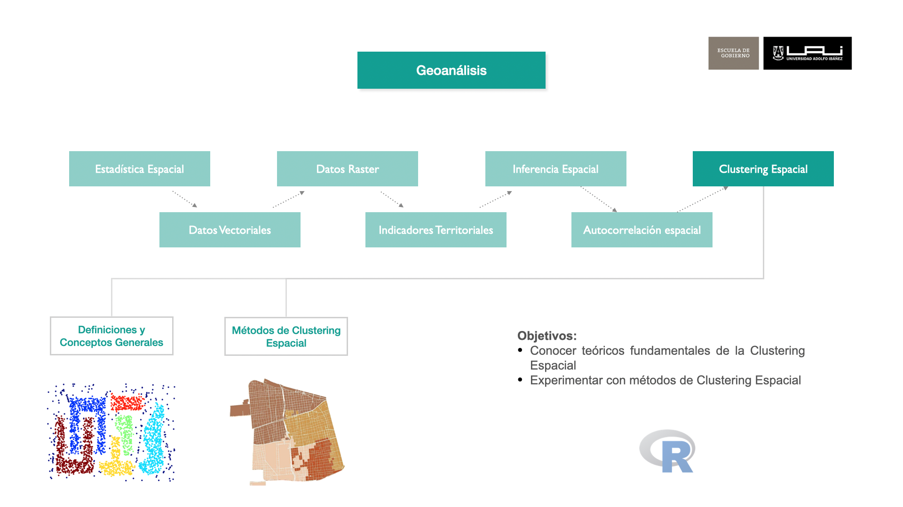

## Objetivos



- Distinguir similitud de atributos, proximidad espacial y continuidad geográfica.
- Preparar datos ráster, manzanas y puntos para tres métodos de agrupamiento.
- Explicar los parámetros y límites de cada método antes de usarlo en políticas públicas.

## Introducción y fundamentos

Un clúster es un grupo formado según una regla de similitud. Imagina ordenar fichas: podemos juntarlas por color, por su posición sobre una mesa o por ambas cosas. Con datos geográficos ocurre lo mismo. Tener coordenadas o dibujar el resultado en un mapa **no convierte automáticamente al método en espacial**: la ubicación debe entrar en la distancia o el algoritmo debe imponer una regla espacial.

| Ejemplo | Unidad | Variables que entran al método | Pregunta |
|---|---|---|---|
| Imagen satelital de Las Condes | Celda de 30 × 30 m | Bandas espectrales | ¿Qué celdas tienen respuestas parecidas? |
| Manzanas censales 2024 | Manzana | Densidad, escolaridad adulta, suficiencia de vivienda y ubicación | ¿Qué manzanas se parecen y están relativamente próximas? |
| Delitos violentos | Punto registrado | Coordenadas UTM | ¿Dónde se agrupan o concentran los casos registrados? |

Los números de clúster son **etiquetas**, no niveles ordenados de gravedad. Una agrupación puede orientar un diagnóstico, pero no demuestra por sí sola la necesidad de un hogar, el tipo de cobertura de una celda ni el riesgo de delito de un barrio.

En los mapas usamos una **paleta cualitativa** de colores contrastantes: el color distingue categorías, sin sugerir que el grupo 2 esté «entre» el 1 y el 3. Una paleta divergente propiamente tal se reserva para una variable ordenada con un punto medio significativo; aquí crearía una relación que los identificadores no tienen.

### Definición de clustering espacial

En sentido estricto, un agrupamiento espacial usa la ubicación en su regla de similitud o exige relaciones espaciales entre observaciones. Los tres ejercicios distinguen estas opciones: similitud espectral **sin coordenadas** en el ráster, atributos **más coordenadas ponderadas** en las manzanas y **solo coordenadas** en los registros de delitos. K-means y el método jerárquico usados aquí no obligan a que cada grupo forme una zona continua.

### Para qué sirve y qué no demuestra

El clustering ayuda a **describir patrones y formular preguntas**. Los grupos dependen de las variables, las escalas y los parámetros elegidos; no son necesariamente categorías naturales ni explican el proceso que produjo los datos. En política pública sirven para orientar la investigación y la planificación cuando se contrastan con otras fuentes.

### Aplicaciones con los datos de este capítulo

| Datos | Uso posible en políticas públicas | Verificación necesaria |
|---|---|---|
| Bandas de la imagen satelital | Seleccionar sectores para inspeccionar vegetación o superficies urbanizadas antes de planificar áreas verdes. | Comparar grupos con imágenes de referencia y trabajo de terreno; una firma espectral no identifica por sí sola una cobertura. |
| Indicadores de manzanas 2024 | Explorar perfiles para focalizar un diagnóstico de vivienda, salud o servicios. | Revisar definiciones, datos faltantes y diferencias dentro de cada manzana; los grupos no son un ranking de necesidad. |
| Puntos de delitos registrados | Localizar concentraciones para estudiar horarios, contexto y despliegue de servicios. | Considerar población expuesta y sesgos de registro; concentración de casos no equivale a tasa ni a efecto de una intervención. |

### Métodos Principales

1.  **K-means**: Particiona los datos en `k` grupos según la distancia a sus centros. Funciona mejor con grupos relativamente compactos en el espacio de variables. Aquí permite comparar firmas espectrales de celdas y perfiles de manzanas; no asigna prioridad por sí solo.
2.  **Clustering jerárquico**: Construye un árbol de distancias y deja elegir el número de grupos después de calcularlo. Aquí muestra cómo se relacionan ubicaciones de delitos registrados a distintos niveles de proximidad.
3.  **DBSCAN**: Este método basado en densidad detecta grupos de forma irregular y clasifica puntos dispersos como ruido. Funciona mejor cuando una sola escala de densidad describe razonablemente los grupos; las densidades muy diferentes pueden exigir otros parámetros o métodos. En seguridad pública permite explorar concentraciones de **casos registrados**, pero no mide riesgo sin un denominador de exposición.

::: {.callout-tip collapse="false"}
## Objetivos de los métodos de clustering

En términos generales se buscan grupos de entidades tales que:

1.  La similitud intragrupo es alta.
2.  La similitud entre grupos es baja.

La elección de **variables, escala y distancia** define qué significa «similar».
:::

## K-means: agrupar por distancia a un centro

**Introducción a K-means.**
K-means es un método de clustering ampliamente utilizado en análisis de datos. Su objetivo es agrupar puntos en `k` clústeres, donde cada punto pertenece al clúster cuyo centroide (centro del clúster) es el más cercano. Este enfoque permite segmentar un conjunto de datos en grupos homogéneos según su proximidad en el espacio de características, haciendo que los puntos en un mismo clúster sean similares entre sí y diferentes de los puntos en otros clústeres.

**Importancia de K-means**

K-means es popular por su simplicidad y eficiencia, lo que lo convierte en una herramienta útil para análisis exploratorio de datos. Permite a los analistas y científicos de datos identificar patrones ocultos y descubrir subgrupos dentro de conjuntos de datos complejos. Esto tiene aplicaciones prácticas en áreas como la segmentación de clientes, la clasificación de imágenes y la detección de patrones en datos geoespaciales.

**Funcionamiento**

El algoritmo K-means sigue los siguientes pasos básicos:

1.  Inicialización: Se eligen k centroides iniciales (ya sea aleatoriamente o utilizando métodos específicos).
2.  Asignación de puntos: Cada punto del conjunto de datos se asigna al clúster cuyo centroide esté más cercano.
3.  Recalcular centroides: Una vez asignados los puntos, se recalcula el centroide de cada clúster, es decir, el punto medio de todos los puntos en el clúster.
4.  Repetición: Los pasos de asignación y recalculación de centroides se repiten hasta que los centroides no cambien significativamente o se alcance un número máximo de iteraciones.

Este proceso reduce la variación dentro de los grupos, pero puede converger a un **óptimo local**. Varios inicios aleatorios ayudan a encontrar una solución mejor.

$$
J = \sum_{i=1}^{k} \sum_{x \in C_i} \| x - \mu_i \|^2
$$ Donde:

-   $k$ es el número total de clústeres.
-   $C_i$ es el conjunto de puntos que pertenecen al clúster $i$ .
-   $x$ es un punto en el clúster $C_i$ .
-   $\mu_i$ es el centroide (o promedio) del clúster $C_i$ .
-   $\| x - \mu_i \|^2$ es la distancia al cuadrado entre el punto $x$ y el centroide $\mu_i$ .

`centers` fija `k` (el método no lo descubre); `nstart` indica cuántos inicios aleatorios se prueban y `iter.max` limita las iteraciones de cada inicio. `set.seed()` hace reproducible la secuencia aleatoria. Una `k` mayor suele reducir la suma de cuadrados incluso si crea grupos poco útiles: conviene comparar tamaños, perfiles y estabilidad, no elegir solo por el error. La [documentación de K-means en R](https://stat.ethz.ch/R-manual/R-devel/library/stats/html/kmeans.html) detalla estos argumentos.

### K-means para ráster (clasificación no supervisada)

**Lectura y recorte.** El TIFF tiene ocho capas. Sus nombres siguen el orden documentado en el [capítulo de ráster](raster.qmd), no se infieren del archivo. `rast()` crea un `SpatRaster`. Usamos el **límite comunal** del mismo shapefile de ese capítulo; lo transformamos al CRS de la imagen (UTM 19S, metros), lo convertimos a `SpatVector`, recortamos el rectángulo de trabajo con `crop()` y dejamos `NA` fuera del límite con `mask()`.

```{r}
library(terra)
library(dplyr)
library(sf)
library(ggplot2)
```


```{r}
# Los identificadores de grupo son categorías sin orden: usamos colores
# cualitativos reordenados para separar visualmente tonalidades parecidas.
colores_grupos <- RColorBrewer::brewer.pal(12, "Paired")[
  c(2, 5, 8, 11, 4, 7, 10, 1, 6, 9, 12, 3)
]
paleta_grupos <- function(niveles) {
  niveles <- setdiff(as.character(niveles), "0")
  stopifnot(length(niveles) <= length(colores_grupos))
  stats::setNames(colores_grupos[seq_along(niveles)], niveles)
}
```


```{r}
r_lc <- terra::rast("data/raster/OLI_LC.tif")

names(r_lc) <- c("aerosol", "blue", "green", "red", "nir",
                 "swir1", "swir2", "thermal")
```


```{r}
mi_comuna <- "LAS CONDES"
comuna_border <- st_read("data/shape/Comunas_Chile.shp", quiet = TRUE) %>%
  filter(REGION == "13", NOM_COMUNA == mi_comuna) %>%
  st_transform(terra::crs(r_lc))

comuna_vect <- terra::vect(comuna_border)
r_lc_masked <- terra::crop(r_lc, comuna_vect, snap = "out") %>%
  terra::mask(comuna_vect)
```

**Variables y celdas válidas.** Seleccionamos seis bandas reflectivas (`blue` a `swir2`). Excluimos `aerosol`, que no necesitamos en esta pregunta, y `thermal`, que representa otra magnitud. **No incluimos `x` ni `y`**: aquí el algoritmo agrupa firmas espectrales; celdas lejanas pueden compartir etiqueta. Para exigir cercanía espacial haría falta incorporarla explícitamente o usar otro método.

`terra::values(..., mat = TRUE)` devuelve una fila por celda en el orden del ráster. Guardamos los índices de celdas que tienen datos en todas las bandas. `scale()` resta la media de cada banda y divide por su desviación estándar, de modo que ninguna domine solo por su rango numérico. Esto no convierte los valores en reflectancia física.

```{r}
bandas <- c("blue", "green", "red", "nir", "swir1", "swir2")
valores <- terra::values(r_lc_masked[[bandas]], mat = TRUE)
celdas_validas <- which(stats::complete.cases(valores))
entradas <- scale(valores[celdas_validas, , drop = FALSE])

centros <- 4
set.seed(42)
kmncluster <- stats::kmeans(entradas, centers = centros,
                            nstart = 20, iter.max = 500,
                            algorithm = "Lloyd")
table(kmncluster$cluster)
```

`centers = 4` fija una resolución exploratoria, **no cuatro tipos reales de cobertura**. `nstart = 20` conserva la mejor solución de veinte inicios aleatorios; `iter.max = 500` limita cada uno y `algorithm = "Lloyd"` elige la variante de actualización de centros. Para interpretar un grupo habría que revisar su firma espectral y contrastar con imágenes o datos de terreno. En una imagen mucho mayor podría entrenarse con una muestra representativa y luego asignar todas las celdas al centro más próximo, documentando ese muestreo.

**Devolver las etiquetas al mapa.** El vector de resultados tiene una etiqueta por celda válida; las demás siguen como `NA`. Al usar los índices conservamos la correspondencia entre filas del modelo y celdas del `SpatRaster`.

```{r}
clases <- rep(NA_integer_, terra::ncell(r_lc_masked))
clases[celdas_validas] <- kmncluster$cluster
kmeans_raster <- r_lc_masked[[1]]
terra::values(kmeans_raster) <- clases
names(kmeans_raster) <- "cluster"

kmeans_raster_df <- terra::as.data.frame(kmeans_raster,
                                        xy = TRUE, na.rm = TRUE)
kmeans_raster_df$cluster <- factor(kmeans_raster_df$cluster)
ggplot(kmeans_raster_df, aes(x = x, y = y, fill = cluster)) +
  geom_raster() +
  coord_equal() +
  scale_fill_manual(values = paleta_grupos(levels(kmeans_raster_df$cluster)),
                    name = "Grupo espectral") +
  labs(title = "Perfiles espectrales de Las Condes",
       subtitle = "Cada color identifica un grupo, no una cobertura validada",
       x = "Este (m)", y = "Norte (m)") +
  theme_minimal()
```

**Mapa interactivo.** `kmeans_raster` contiene enteros, pero `mapview()` los interpreta como valores continuos. Convertimos el ráster a factor y asociamos una etiqueta a cada identificador. Así, la leyenda muestra cuatro categorías con los mismos colores del mapa anterior; el número del grupo no expresa una escala.

```{r}
kmeans_raster_categorico <- terra::as.factor(kmeans_raster)
levels(kmeans_raster_categorico) <- data.frame(
  value = seq_len(centros),
  grupo = paste("Grupo", seq_len(centros))
)

mapview::mapview(
  kmeans_raster_categorico,
  na.color = NA,
  col.regions = unname(paleta_grupos(as.character(seq_len(centros)))),
  legend = TRUE,
  layer.name = "Grupo espectral"
)
```

Una aplicación en políticas públicas sería **seleccionar lugares para verificar cobertura vegetal o superficies urbanizadas** antes de planificar áreas verdes. No se deben estimar hectáreas de parque directamente a partir de etiquetas sin validación temática. La [documentación de `terra::crop()`](https://search.r-project.org/CRAN/refmans/terra/help/crop.html) explica por qué recorte y máscara cumplen funciones distintas.

### K-means de manzanas 2024: atributos y ubicación

La unidad ahora es la **manzana urbana del Censo 2024**. Usaremos `n_per` (población total; el archivo no contiene una columna llamada `n_pers`), `IEA` (promedio de escolaridad de la población de 18 años o más) e `ISV` (proxy de suficiencia de vivienda construido con señales de hacinamiento), además de la ubicación. **Un `ISV` alto indica mayor suficiencia, no más hacinamiento.** Son indicadores derivados para el curso, explicados en [indicadores territoriales](indicadores_territoriales.qmd); la escolaridad no mide por sí sola ingresos o nivel socioeconómico.

**Selección del área de estudio**

Seleccionamos las manzanas urbanas de Las Condes. El archivo ya está en UTM 19S (`EPSG:32719`); dejamos la transformación explícita para asegurar que las distancias y áreas se expresen en metros y metros cuadrados.

```{r}
mi_comuna <- "LAS CONDES"
mz_comuna <- readRDS(
  "data/results/R13_Santiago_urbano_ind_socioeconomicos_2024.rds"
) %>%
  filter(COMUNA == mi_comuna) %>%
  st_transform(32719)

n_original <- nrow(mz_comuna)
```

**Preparación de datos**

Calculamos el área de cada polígono con `st_area()`; en UTM 19S el resultado está en m². La densidad es `n_per / área_m2 * 10000`, en habitantes por hectárea. Conservamos manzanas con población positiva, área positiva e indicadores finitos. Hacemos el filtro **antes** de estandarizar, para que las medias y desviaciones correspondan a las unidades que entran al modelo. `ISV` suele concentrarse cerca de 1 en esta comuna; revisaremos los perfiles porque esa distribución puede influir en los grupos.

`n_per` procede de una base derivada con redistribución espacial de tabulados; algunas cifras pueden ser fraccionarias. La densidad se interpreta como una **estimación para la geometría utilizada**, no como un conteo exacto de residentes por manzana.

```{r}
datos_sf <- mz_comuna %>%
  mutate(area_m2 = as.numeric(st_area(.))) %>%
  mutate(densidad_ha = n_per / area_m2 * 10000) %>%
  filter(is.finite(n_per), n_per > 0,
         is.finite(area_m2), area_m2 > 0,
         if_all(c(densidad_ha, IEA, ISV), is.finite)) %>%
  dplyr::select(ID_MANZ, n_per, area_m2, densidad_ha, IEA, ISV)

tibble(unidades_originales = n_original,
       unidades_analizadas = nrow(datos_sf),
       unidades_excluidas = n_original - nrow(datos_sf))
```

**Extracción de coordenadas y ponderación**

`st_point_on_surface()` elige un punto representativo dentro de cada polígono. Las coordenadas UTM están en metros, pero se estandarizan antes de mezclarlas con los atributos. `peso_espacial = 1.5` multiplica las dos coordenadas estandarizadas: con 0 se agruparía solo por atributos; con un valor mayor, la posición pesaría más. Es una **decisión analítica**, no un valor universal. No garantiza que los grupos sean contiguos.

```{r}
xy_manzanas <- st_geometry(datos_sf) %>%
  st_point_on_surface() %>% st_coordinates()
peso_espacial <- 1.5
datos_clustering <- cbind(
  scale(st_drop_geometry(datos_sf)[,
    c("densidad_ha", "IEA", "ISV")]),
  peso_espacial * scale(xy_manzanas)
)
colnames(datos_clustering) <- c("densidad_ha", "IEA", "ISV",
                                "X", "Y")
```

**Ejecución de K-means**

Entran las **cinco** columnas mostradas arriba. `k = 7` fija siete grupos y `nstart = 20` reduce la dependencia del inicio. Como K-means usa distancias cuadradas, cada eje espacial queda ponderado por $1.5^2 = 2.25$ frente a cada atributo estandarizado: en esta configuración la ubicación tiene bastante influencia. Conviene repetir con otros pesos y valores de `k` para ver si las conclusiones cambian.

```{r}
set.seed(42)
k <- 7
kmeans_result <- stats::kmeans(datos_clustering, centers = k,
                               nstart = 20, iter.max = 100)
```

**Post procesamiento**

Este bloque añade el resultado del clustering (los identificadores de clúster) al DataFrame espacial datos_sf como una nueva columna cluster. Esto facilita la visualización y el análisis de los clústeres dentro de la geometría espacial original.

```{r}
# Agregar los resultados del clustering al objeto espacial
datos_sf$cluster <- factor(kmeans_result$cluster)
```

**Visualización de resultados**

Cada manzana se colorea según su grupo. El color identifica el perfil y no representa una escala de necesidad o prioridad.

```{r}
ggplot() +
  geom_sf(data = datos_sf, aes(fill = cluster), color = NA) +
  scale_fill_manual(values = paleta_grupos(levels(datos_sf$cluster)),
                    name = "Grupo") +
  labs(title = "Perfiles de manzanas de Las Condes") +
  theme_minimal()

```

```{r}
datos_sf %>% st_drop_geometry() %>%
  group_by(cluster) %>%
  summarise(n_manzanas = n(),
            densidad_mediana = median(densidad_ha),
            IEA_mediana = median(IEA),
            ISV_mediana = median(ISV),
            .groups = "drop")
```

El mapa y la tabla pueden orientar **dónde profundizar un diagnóstico de vivienda o servicios**. `IEA` está en años promedio; `ISV` es un proxy relativo y valores mayores indican **más suficiencia habitacional**. La escala de colores identifica grupos sin orden y los promedios por manzana ocultan diferencias entre hogares.

## Clustering Jerárquico

**Introducción al Clustering Jerárquico**

El clustering jerárquico organiza las observaciones en un árbol o dendrograma. Es como construir un árbol genealógico de similitudes: las ramas que se unen a menor altura son más próximas según la distancia elegida. El árbol se construye sin fijar un número de grupos, pero para dibujar un mapa de grupos sí debemos elegir **dónde cortarlo**.

**Importancia del Clustering Jerárquico**

Este método es especialmente útil cuando queremos entender las relaciones entre los datos en diferentes niveles de similitud, ya que nos permite identificar subgrupos dentro de los grupos mayores. Es comúnmente utilizado en la biología para clasificar especies, en procesamiento de texto para agrupar documentos, y en análisis geoespacial para identificar patrones de proximidad y similitud en los datos.

**Funcionamiento**

El clustering jerárquico puede ser de dos tipos:

-   Aglomerativo (de abajo hacia arriba): Comienza con cada punto en su propio clúster y, en cada paso, combina los clústeres más similares hasta que todos los puntos están en un solo clúster.
-   Divisivo (de arriba hacia abajo): Comienza con todos los puntos en un solo clúster y, en cada paso, divide el clúster menos homogéneo hasta que cada punto está en su propio clúster.

El proceso aglomerativo es el más común y sigue estos pasos básicos:

1.  Calcular la matriz de distancias: Calcular las distancias entre todos los puntos en el conjunto de datos.
2.  Combinar los clústeres más cercanos según un **criterio de enlace**: no basta con decir «los más cercanos» sin definir cómo se mide la distancia entre grupos.
3.  Actualizar la matriz de distancias: Recalcular las distancias entre los nuevos clústeres combinados y los otros clústeres.
4.  Repetir hasta obtener un único clúster: Continuar agrupando hasta que todos los puntos se encuentren en un único clúster, formando así un dendrograma.

**Fórmula del Clustering Jerárquico**

En cada paso, la distancia entre dos clústeres $C_i$ y $C_j$ se calcula de diferentes formas, dependiendo del criterio de enlace seleccionado:

1.  Enlace Completo:

$$d(C_i, C_j) = \max \{ d(x, y) : x \in C_i, y \in C_j \}$$

Aquí, la distancia entre dos clústeres es la máxima distancia entre cualquier par de puntos en los dos clústeres.

2.  Enlace Simple:

$$d(C_i, C_j) = \min \{ d(x, y) : x \in C_i, y \in C_j \}$$

En este caso, se utiliza la mínima distancia entre cualquier par de puntos.

3.  Enlace Promedio:

$$d(C_i, C_j) = \frac{1}{|C_i| \times |C_j|} \sum_{x \in C_i} \sum_{y \in C_j} d(x, y)$$

Calcula la distancia promedio entre todos los pares de puntos entre los clústeres.

4.  Enlace de centroide: calcula la distancia entre las medias de los grupos. Es otra definición posible y puede producir un árbol distinto.

**Interpretación del Dendrograma**

El dendrograma resultante muestra cómo se fusionan los clústeres en diferentes niveles de similitud. Al cortar el dendrograma a diferentes alturas, puedes obtener distintos números de clústeres, permitiendo una segmentación flexible y adaptativa de los datos.

En este ejemplo `dist()` usa distancia euclidiana entre coordenadas UTM, expresada en **metros**, y `method = "complete"` usa la **mayor distancia** entre un punto de cada grupo. Esto limita la extensión interna de las agrupaciones. La matriz de distancias crece aproximadamente como $n(n-1)/2$; con muchos registros puede consumir mucha memoria.

### Clustering jerárquico de delitos en el área urbana

**Lectura y visualización de insumos**

El archivo contiene puntos de casos registrados con `x` e `y` en EPSG:32719. Para evitar un mapa dominado por la parte cordillerana sin registros, aquí usamos **las zonas urbanas de Las Condes** como área de estudio. Unimos sus polígonos y conservamos solo los casos que caen dentro. Mostramos cuántos registros quedan fuera: antes de una aplicación pública conviene revisar posibles diferencias de geocodificación o delimitación. Agrupar ubicaciones de registros no mide tasas ni establece causas.

```{r}

#lectura
violencia_df <- readRDS(file = "data/delitos/casos_violencia.rds")
head(violencia_df)

# El límite urbano es distinto del límite comunal usado para el ráster.
zonas_urbanas <- readRDS("data/censo/zonas_urb_consolidadas.rds") %>%
  filter(NOM_COMUNA == mi_comuna) %>%
  st_transform(32719)

limite_urbano <- st_sf(
  geometry = st_union(st_geometry(zonas_urbanas))
)

# Dataframe to sf object
violencia <-  st_as_sf(x = violencia_df, 
                          coords = c("x", "y"), crs = 32719)
fuera_area_urbana <- sum(lengths(st_intersects(violencia,
                                               limite_urbano)) == 0)
fuera_area_urbana
violencia <- st_filter(violencia, limite_urbano)


# Visualización inicial
ggplot() +
  geom_sf(data = limite_urbano, fill = NA, color = "gray50") +
  geom_sf(data = violencia,  color =  "red", 
          alpha=0.8,  size= 0.1)+
  ggtitle("Casos registrados en el área urbana de Las Condes") +
  theme_bw() +
  theme(panel.grid.major = element_line(colour = "gray80"), 
        panel.grid.minor = element_line(colour = "gray80"))
```

**Extracción de Coordenadas**

Extraemos solo las coordenadas. Así la distancia depende de la separación geográfica en metros, sin incluir identificadores ni atributos del registro.

```{r}
# Extraer las coordenadas y variables para clustering
coords_delitos <- st_coordinates(violencia)
head(coords_delitos)
```

**Cálculo de Clustering Jerárquico**

`linkage = "complete"` define cómo se construye el árbol. `k = 10` solo fija el **corte** para el mapa, no altera el árbol. Comparar otros cortes permite evaluar si el patrón visual es estable.

```{r}
k <- 10

linkage <- "complete"
object <- hclust(dist(coords_delitos), method = linkage)
hclust_result <- cutree(object, k = k)
```

Posteriormente se añade los resultados del clustering como una nueva columna hclust_cluster en el objeto espacial violencia para asociar cada punto con su clúster respectivo. Luego, muestra la distribución de puntos en cada clúster.

```{r}
# Agregar resultados al DataFrame espacial
violencia$hclust_cluster <- factor(hclust_result)
table(violencia$hclust_cluster)
```

**Visualización de Resultados**

Finalmente se crea un mapa con clúster jerárquico que permite analizar la distribución y agrupación de los delitos violentos en la comuna.

```{r}
ggplot() +
  geom_sf(data = limite_urbano, fill = NA, color = "gray50" )+
  geom_sf(data = violencia, aes(color = hclust_cluster), alpha = 1, size = 0.3) +
  scale_color_manual(values = paleta_grupos(levels(violencia$hclust_cluster))) +
  labs(title = "Agrupamiento jerárquico de casos registrados", color = "Rama") +
  theme_minimal()

# mapview(violencia, zcol = "hclust_cluster",  cex=0.5)
```

## Clustering DBSCAN

**Introducción al Clustering DBSCAN**

DBSCAN (Density-Based Spatial Clustering of Applications with Noise) agrupa puntos según la densidad de sus vecindades. A diferencia de K-means, no exige fijar el número de grupos y puede seguir concentraciones de forma irregular. Los puntos que no quedan conectados a una concentración reciben la etiqueta de ruido.

**Importancia de DBSCAN**

DBSCAN es útil cuando hay áreas densas mezcladas con puntos dispersos. Un solo par de parámetros puede ser inadecuado si hay densidades muy diferentes. En el ejemplo sirve para **explorar concentraciones de casos registrados**, no para identificar automáticamente zonas de mayor riesgo.

**Funcionamiento**

DBSCAN identifica los clústeres mediante dos parámetros clave:

1.  `eps`: Radio de búsqueda. Aquí se mide en **metros** porque las coordenadas están en UTM.

2.  `minPts`: Número mínimo de puntos dentro de `eps` para que un punto sea núcleo, **incluido el propio punto**. Un punto de borde puede incorporarse al grupo sin llegar a ese mínimo.

El algoritmo sigue estos pasos:

1.  Clasificar puntos:

-   Punto central: Un punto que tiene al menos minPts puntos dentro de su radio eps.
-   Punto frontera: Un punto que tiene menos de minPts puntos en su vecindad pero está dentro de la vecindad de un punto central.
-   Punto de ruido: Un punto que no es ni central ni frontera.

2.  Expansión del clúster:

-   DBSCAN elige un punto central no visitado y lo expande, agrupando todos los puntos dentro de su radio eps como parte del clúster.
-   Si un punto frontera se encuentra en la vecindad, también se incluye en el clúster.
-   Continúa expandiendo hasta que no quedan más puntos alcanzables en ese clúster, luego pasa a otro punto central no visitado.

3.  Identificación de puntos de ruido: Los puntos que no cumplen con los requisitos para ser un punto central o frontera son etiquetados como ruido.

**Fórmula para DBSCAN**

DBSCAN se basa en una función de vecindad por densidad:

$$N_\epsilon(p) = \{q \in D \mid \operatorname{dist}(p, q) \leq \epsilon\}$$

Donde:

-   $N_\epsilon(p)$ es la vecindad de un punto $p$ dentro del radio $\epsilon$.

-   $\operatorname{dist}(p, q)$ es la distancia entre los puntos $p$ y $q$.

-   $\epsilon(eps)$ es el radio de vecindad que define la proximidad.

Para cada punto:

-   Si $|N_\epsilon(p)| \geq \text{minPts}$, el punto p es considerado un punto central.

-   Si no, el punto p puede ser un punto frontera si está en la vecindad de un punto central, o ruido si no pertenece a ningún clúster.

**Ventajas y Limitaciones**

-   Ventajas: Puede seguir grupos de forma irregular, distingue puntos dispersos como ruido y no requiere fijar el número de grupos.

-   Limitaciones: La efectividad depende de `eps` y `minPts`; un único radio y umbral puede no representar bien zonas con densidades muy distintas.

**Interpretación**

Los clústeres representan concentraciones según el radio y el umbral elegidos; el ruido corresponde a puntos no alcanzados por ellas. Si las densidades varían mucho entre sectores, hay que revisar si una sola configuración puede describirlos adecuadamente.

### DBSCAN de delitos en el área urbana

Usamos las mismas coordenadas del ejemplo jerárquico. En este caso el grupo `0` significa **ruido**; los demás números solo identifican agrupaciones. Consulta la [documentación de `dbscan`](https://search.r-project.org/CRAN/refmans/dbscan/html/dbscan.html) para la definición de puntos núcleo y borde.

```{r}
head(coords_delitos)
```

**Parámetros**

Probamos primero `eps = 100` m y `minPts = 40` registros, incluido el punto central. Son valores **ilustrativos**: su pertinencia depende del período observado y de la escala de la intervención pública.

```{r}
# eps: radio de búsqueda para formar clústeres
# minPts: número mínimo de puntos para formar un clúster
eps <- 100
minPts <- 40
```

**Cálculo de clustering DBSCAN**

Aplicamos DBSCAN a la matriz de coordenadas `coords_delitos` con estos valores iniciales.

```{r}
# Ejecutar DBSCAN con los parámetros iniciales
library(dbscan)
dbscan_result_v1 <- dbscan(coords_delitos, eps = eps, minPts = minPts)
```

Luego se asigna el resultado del clustering como una columna cluster en el objeto violencia para identificar el clúster asignado a cada punto. Luego muestra la distribución de puntos en cada clúster.

```{r}
# Agregar resultados al DataFrame espacial
violencia$dbscan_cluster_v1 <- factor(dbscan_result_v1$cluster)
table(violencia$dbscan_cluster_v1 )
```

**Visualización de Resultados v1**

El mapa muestra los grupos de puntos densos y conserva el ruido en gris para no ocultar los casos dispersos.

```{r}
ggplot() +
  geom_sf(data = limite_urbano, fill = NA, color = "gray50" )+
  geom_sf(data = violencia %>% filter(dbscan_cluster_v1 == "0"),
          color = "gray65", alpha = 0.35, size = 0.3) +
  geom_sf(data = violencia %>% filter(dbscan_cluster_v1 !="0"),
          aes(color = dbscan_cluster_v1), alpha = 1, size = 0.3) +
  scale_color_manual(values = paleta_grupos(levels(violencia$dbscan_cluster_v1))) +
  labs(title = "Clustering DBSCAN de Delitos", color = "Clúster") +
  theme_minimal()

```

**Lectura del gráfico de distancias**

Primero fijamos `minPts`, porque **el gráfico cambia cuando cambia ese parámetro**. Para comparar concentraciones relativamente marcadas usaremos `minPts = 100`: un punto núcleo necesita otros 99 casos dentro de su radio. Es una definición didáctica de «concentración marcada», no un umbral oficial de seguridad pública. La [documentación de `dbscan`](https://search.r-project.org/CRAN/refmans/dbscan/html/dbscan.html) indica que el gráfico debe usar el vecino `minPts - 1`. Calculamos esas distancias con `kNNdist(..., k = 99)` y las ordenamos.

Cada posición horizontal representa **un caso ordenado por distancia**, no una ubicación en el mapa. La altura muestra cuántos metros lo separan de su vecino 99.º. Si su distancia está **por debajo** de una línea horizontal, ese caso tiene al menos 100 puntos —incluido él mismo— dentro del radio indicado y puede ser núcleo. Los casos sobre la línea no son núcleo a ese radio, aunque algunos podrían incorporarse como puntos de borde. El ascenso fuerte al extremo derecho corresponde a sectores más dispersos; aquí **no hay un codo único y nítido** que determine automáticamente `eps`.

```{r}
minPts_comparacion <- 100
distancias_vecino <- dbscan::kNNdist(
  coords_delitos, k = minPts_comparacion - 1
)
plot(sort(distancias_vecino), type = "l",
     main = "Distancia al vecino 99.º de cada caso",
     xlab = "Casos ordenados por distancia",
     ylab = "Distancia al vecino 99.º (m)")
abline(h = c(250, 300, 350),
       col = c("#7F7F7F", "#D62728", "#1F77B4"), lty = 2)
legend("topleft", legend = c("250 m", "300 m", "350 m"),
       col = c("#7F7F7F", "#D62728", "#1F77B4"),
       lty = 2, bty = "n")
```

**Grilla de Combinaciones de Parámetros**

La cuadrícula permite comparar sensibilidad: cuántos grupos se forman, qué porcentaje de registros queda como ruido y qué proporción de **todos los casos** absorbe el grupo más grande. Esta última cifra muestra cuándo varios focos se fusionan en una gran región. **Maximizar el número de grupos no es un criterio de calidad**; puede fragmentar un mismo fenómeno.

```{r}

eps_options <- seq(100, 400, by = 50)
minPts_options <- c(20, 40, 80, 100)
params <- expand.grid(eps = eps_options, minPts = minPts_options)
```

La función calcula las tres medidas para cada combinación. El cero se excluye del número de grupos, pero sí cuenta para el porcentaje de ruido. Si no se forma ningún grupo, la proporción del grupo más grande se registra como cero.

```{r}
# Función de diagnóstico, no de optimización automática
run_dbscan <- function(eps, minPts, coordenadas) {
  grupos <- dbscan::dbscan(coordenadas, eps = eps,
                           minPts = minPts)$cluster
  tamanos <- table(grupos[grupos != 0L])
  data.frame(n_grupos = length(setdiff(unique(grupos), 0L)),
             pct_ruido = round(mean(grupos == 0L) * 100, 1),
             pct_mayor_grupo = if (length(tamanos) > 0) {
               round(max(tamanos) / length(grupos) * 100, 1)
             } else 0)
}
```

Comparamos las combinaciones sin declarar una ganadora automática. Demasiado ruido puede dejar áreas de interés fuera; demasiado poco puede unir concentraciones que son distintas para la pregunta de política pública.

```{r}
resultados <- lapply(seq_len(nrow(params)), function(i) {
  cbind(params[i, ],
        run_dbscan(params$eps[i], params$minPts[i], coords_delitos))
}) %>% bind_rows()
resultados
```

**Cómo elegir con la tabla.** Para esta clase fijamos la pregunta: queremos **varios focos locales**, aceptar hasta alrededor de la mitad de los casos como ruido y evitar que un único grupo abarque gran parte de la comuna. Con `minPts = 100`, comparemos tres radios próximos:

```{r}
resultados %>%
  filter(minPts == minPts_comparacion, eps %in% c(250, 300, 350)) %>%
  knitr::kable(
    col.names = c("Radio (m)", "Mínimo", "Grupos", "Ruido (%)",
                  "Mayor grupo (% de todos los casos)"),
    caption = paste0("Tres radios con minPts = 100; porcentajes respecto de ",
                     formatC(nrow(violencia), format = "d", big.mark = ".",
                             decimal.mark = ","),
                     " casos urbanos.")
  )
```

- **250 m:** aparecen 9 grupos, pero el **66,2 %** de los registros queda como ruido. La regla identifica focos muy compactos y deja fuera gran parte de los casos.
- **300 m:** siguen apareciendo 9 grupos; el ruido baja al **44,6 %** y el mayor grupo representa el **16,3 %** de todos los casos. Conserva varios focos sin unir la mayor parte de los registros.
- **350 m:** el ruido baja al **24,0 %**, pero quedan 5 grupos y el mayor reúne el **41,6 %** de todos los casos. El radio empieza a fusionar focos que queríamos distinguir.

**Elección para el ejercicio:** `eps = 300` m y `minPts = 100`. La tabla muestra el compromiso y el gráfico comprueba qué densidad local exige ese radio. En estos datos, alrededor del **27 %** de los casos tiene al menos 99 vecinos dentro de 300 m; otros pueden ser puntos de borde. Este par es **preferible para la pregunta didáctica definida**, no un óptimo estadístico universal. Si el objetivo fuera describir concentraciones más pequeñas o cubrir más registros, cambiarían los criterios y posiblemente la elección.

```{r}
eps <- 300
minPts <- 100

# Aplicar la configuración elegida para el ejercicio
dbscan_result_v2 <- dbscan(coords_delitos, eps = eps, minPts = minPts)
unique(dbscan_result_v2$cluster)
```

Asignamos los grupos a los puntos y revisamos también cuántos quedaron en ruido (`0`).

```{r}
# Agregar resultados al DataFrame espacial
violencia$dbscan_cluster_v2 <- factor(dbscan_result_v2$cluster)
table(violencia$dbscan_cluster_v2)
```

**Visualización de Resultados**

El mapa conserva el ruido en gris. Los colores no expresan magnitud ni riesgo.

```{r}
ggplot() +
  geom_sf(data = limite_urbano, fill = NA, color = "gray50" )+
  geom_sf(data = violencia %>% filter(dbscan_cluster_v2 == "0"),
          color = "gray65", alpha = 0.35, size = 0.3) +
  geom_sf(data = violencia %>% filter(dbscan_cluster_v2!="0"),
          aes(color = dbscan_cluster_v2), alpha = 1, size = 0.3) +
  scale_color_manual(values = paleta_grupos(levels(violencia$dbscan_cluster_v2))) +
  labs(title = "Clustering DBSCAN de Delitos", color = "Clúster") +
  theme_minimal()

```

## Resumen

El clustering es una **herramienta exploratoria**: convierte una definición de similitud en grupos que podemos describir y comparar. En este capítulo usamos K-means, clustering jerárquico y DBSCAN sobre tres unidades distintas. La definición de las variables, la distancia y los parámetros cambia la pregunta que responde cada mapa.

La elección depende de los datos y del objetivo:

-   **K-means espectral** responde qué píxeles tienen firmas parecidas; requiere revisar metadatos y validar coberturas en terreno.
-   **K-means de manzanas** combina atributos y ubicación aproximada; requiere justificar pesos, `k` y definiciones de los indicadores.
-   **Jerárquico** permite explorar cortes de un árbol de distancias; requiere elegir enlace y controlar el costo de memoria.
-   **DBSCAN** muestra concentraciones de puntos y ruido; requiere justificar radio, umbral, período de observación y población expuesta.

Para una decisión pública hay que verificar la estabilidad de los grupos, contrastarlos con evidencia sustantiva y explicar los sesgos de los datos. Un mapa de agrupamientos **no evalúa por sí mismo el impacto causal** de una política.
