```{r setup, include=FALSE}
knitr::opts_chunk$set(echo = TRUE)
suppressPackageStartupMessages(library(dplyr))
suppressPackageStartupMessages(library(sf))
suppressPackageStartupMessages(library(terra))
suppressPackageStartupMessages(library(ggplot2))
options(scipen = 999)
```

## Introducción

En el capítulo de [datos vectoriales](datos_vectoriales.qmd) trabajamos con puntos, líneas y polígonos: objetos que tienen una geometría y atributos. Los datos **raster** representan el territorio de otra manera: lo dividen en una cuadrícula y guardan un valor en cada celda. Pueden representar mediciones de temperatura o elevación, categorías de uso del suelo y también superficies calculadas a partir de otros datos.

Las **imágenes satelitales** son una fuente frecuente de datos ráster, pero no la única. Una cuadrícula de densidad de eventos o una superficie interpolada a partir de puntos también es un ráster. Más adelante retomaremos estas superficies en el capítulo de inferencia espacial (Módulo 5), con métodos como KDE e IDW. Aquí aprenderemos primero la estructura común a todos los rásteres y luego usaremos una imagen satelital como caso aplicado.

En políticas públicas, muchas preguntas se formulan para unidades administrativas: *¿qué proporción de una manzana tiene cobertura vegetal?* Para responderlas podemos combinar una imagen ráster con los polígonos de las manzanas. Esa transición de **píxeles a territorios** será el hilo conductor de este capítulo.

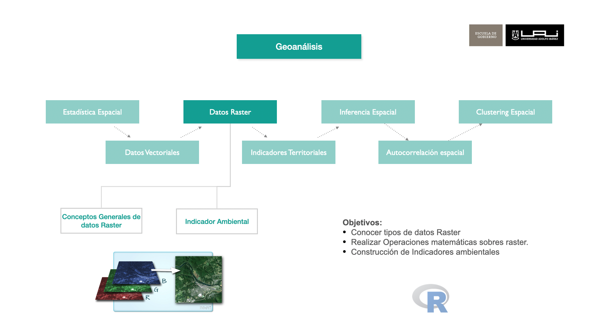

**Al terminar este capítulo podrás:**

-   Reconocer qué representa una celda y por qué importan la resolución, las bandas y el sistema de referencia.
-   Leer, visualizar y recortar un ráster con `terra`.
-   Calcular un índice de vegetación y convertirlo en una medida por manzana.
-   Interpretar el resultado considerando sus datos faltantes y sus límites de uso.

## Cómo se organiza un ráster

### Celdas, valores y resolución

Un ráster es una matriz de filas y columnas ubicada en el espacio. Cada celda, también llamada **píxel**, tiene un valor. Ese valor puede ser una medición continua (por ejemplo, temperatura), una categoría (por ejemplo, tipo de cobertura) o un código que aún debe convertirse a una unidad física.

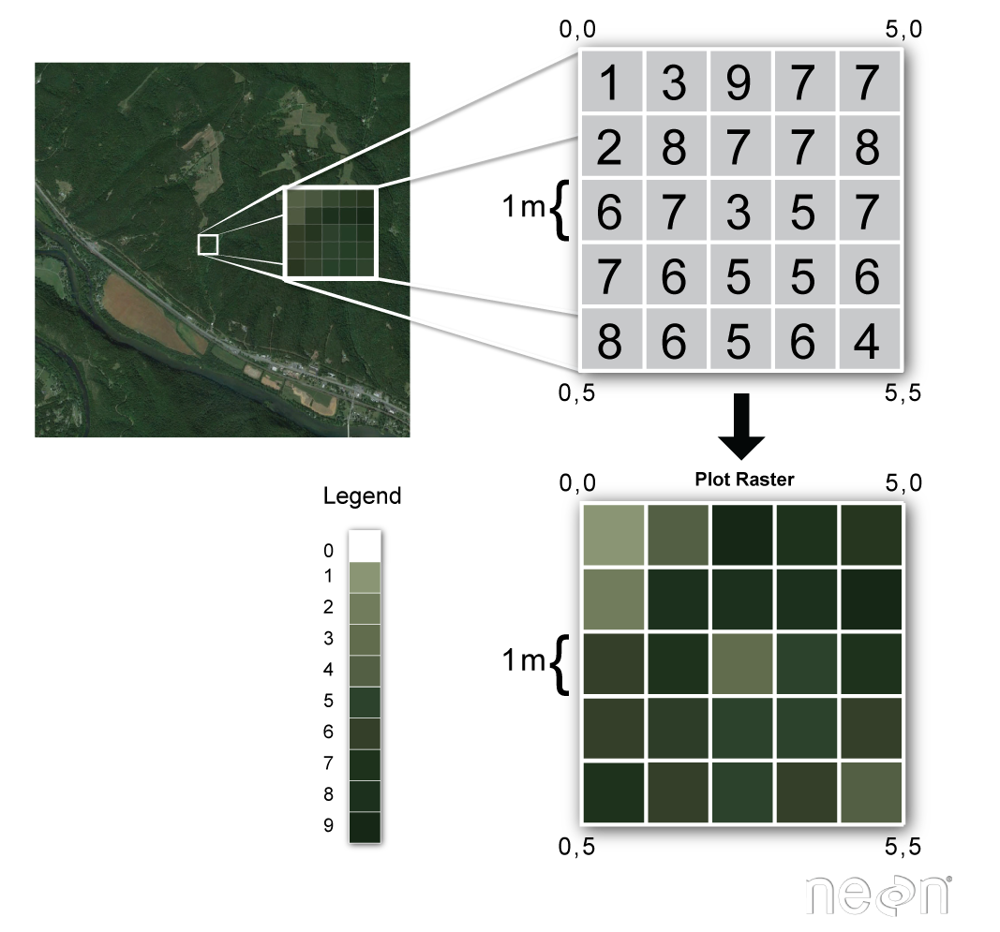{fig-align="center" width="500"}


La **resolución espacial** indica el tamaño de cada celda sobre el terreno. Una celda más pequeña permite representar detalles más finos, pero no crea información nueva por sí sola. En una imagen importa cómo y cuándo se observó el territorio; en una superficie calculada, importan los datos de entrada y las decisiones del método, como el ancho de banda de KDE o los puntos usados por IDW. En ambos casos, la cuadrícula debe elegirse de acuerdo con la pregunta que queremos responder.

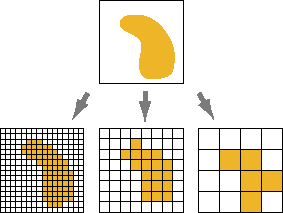{fig-align="center" width="400"}

Como en los datos vectoriales, el **sistema de referencia de coordenadas (CRS)** indica dónde está el dato. Para cruzar un ráster con comunas o manzanas, ambas capas deben usar el mismo CRS. Si el ráster está en un sistema proyectado en metros, también podemos interpretar su tamaño de celda en metros. El [anexo sobre CRS](crs.qmd) explica estos sistemas y muestra cómo reproyectar vectores y rásteres.

### Bandas: varias mediciones en la misma cuadrícula

Una imagen satelital suele tener varias **bandas**: cada una registra una parte distinta de la radiación observada por el sensor. Podemos pensar en ellas como capas alineadas, con una medición por celda. La banda roja y la del infrarrojo cercano, por ejemplo, se combinan para construir un índice de vegetación. Otros rásteres también pueden tener varias capas, aunque no sean bandas espectrales.

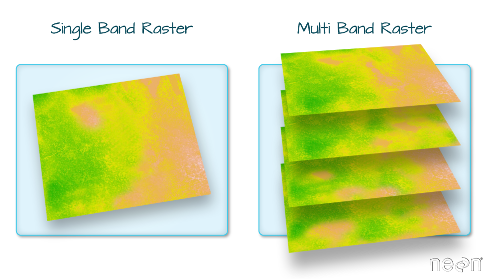{fig-align="center" width="600"}

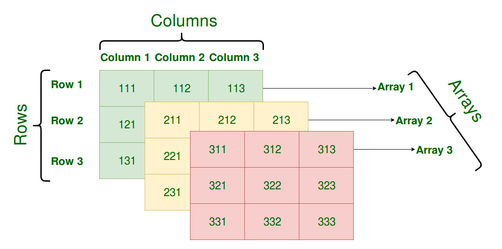{fig-align="center" width="500"}

| Concepto | Pregunta útil antes de analizar |
|---|---|
| Resolución espacial | ¿Qué tamaño de objeto puedo distinguir? |
| Fecha y frecuencia de observación | ¿La imagen corresponde al período que quiero estudiar? |
| Bandas | ¿Qué mide cada capa y en qué orden aparece? |
| Valores y datos faltantes | ¿Son mediciones listas para usar? ¿Hay nubes o zonas sin datos? |
| CRS | ¿Coincide con el de mis polígonos? |

## Trabajar con ráster en R

Usaremos `terra`, cuyo objeto principal es `SpatRaster`. Primero construiremos una cuadrícula pequeña con un problema territorial concreto; después pasaremos a una imagen real.

### Crear un modelo de elevación sencillo

Imaginemos una franja costera **simulada**. Cada celda de 100 × 100 metros contiene una elevación en metros sobre el nivel del mar. Los valores bajos están hacia el borde izquierdo de la matriz y aumentan hacia el interior. Un modelo digital de elevación real tendría muchas más celdas y provendría de mediciones del terreno; esta matriz pequeña permite ver qué hace cada operación.

```{r}
r <- rast(nrows = 5, ncols = 6,
          xmin = 280000, xmax = 280600,
          ymin = 6280000, ymax = 6280500,
          crs = "EPSG:32719")

alturas <- matrix(c(
   0,  2,  5, 15, 28, 45,
   0,  1,  8, 17, 32, 58,
   0,  4, 12, 24, 38, 65,
   0,  6, 18, 29, 42, 76,
   0, 10, 22, 34, 55, 90
), nrow = 5, byrow = TRUE)

values(r) <- as.vector(t(alturas))
names(r) <- "elevacion_m"
as.matrix(r, wide = TRUE)
plot(r, main = "Elevación simulada (m)")
```

### Operaciones matemáticas celda por celda

Las operaciones aritméticas se aplican a cada celda sin cambiar su posición. Si queremos comparar la elevación con una cota de 30 metros, podemos restar 30: un resultado negativo indica cuántos metros está la celda **por debajo** de esa cota. Dividir por 1000 expresa la misma elevación en kilómetros, aunque para este ejercicio los metros son más fáciles de interpretar.

```{r}
margen_30m <- r - 30
elevacion_km <- r / 1000

as.matrix(margen_30m, wide = TRUE)
as.matrix(elevacion_km, wide = TRUE)
```

Una comparación crea otra capa: `r<30` devuelve `TRUE` en las celdas bajo la cota y `FALSE` en las demás. Observa que una celda con valor **30** queda fuera del grupo «bajo 30».

```{r}
as.matrix(r < 30, wide = TRUE)
```

### Aplicar una función con `app()`

`app()` aplica una función a las celdas. Aquí calculamos **cuántos metros faltan para alcanzar la cota 30**. En las celdas que ya están a 30 metros o más, la diferencia se fija en cero con `pmax()`.

```{r}
metros_hasta_30 <- app(r, fun = function(altura) {
  pmax(30 - altura, 0)
})
names(metros_hasta_30) <- "metros_hasta_30"

as.matrix(metros_hasta_30, wide = TRUE)
```

### Reclasificar con `classify()`

Para convertir elevaciones continuas en dos grupos, `terra::classify()` usa una tabla de reglas. La primera fila asigna **0** a valores menores que 30; la segunda asigna **1** a valores desde 30 en adelante. `right = FALSE` hace que el límite inferior de cada intervalo esté incluido: la celda de 30 metros pertenece al segundo grupo.

```{r}
reglas_cota <- matrix(c(
  -Inf, 30, 0,
    30, Inf, 1
), ncol = 3, byrow = TRUE)

clase_cota <- classify(r, reglas_cota, right = FALSE)
names(clase_cota) <- "clase_cota"

as.matrix(clase_cota, wide = TRUE)
plot(clase_cota, main = "0: bajo 30 m; 1: 30 m o más")
```

En este ejercicio, el **0** señala celdas que priorizaríamos para revisar su exposición a tsunami; el **1** solo indica que superan la cota de referencia. Es una primera selección, no una declaración de seguridad.

### Combinar capas con `lapp()`

Supongamos ahora que tenemos una segunda capa con **personas por celda**, también simulada. Las dos capas tienen la misma extensión, resolución y CRS, de modo que cada posición se refiere al mismo lugar. `lapp()` recibe una función con un argumento por capa; conservaremos el número de personas solo donde la elevación es menor que 30 metros.

```{r}
personas <- r
values(personas) <- as.vector(t(matrix(c(
   0, 12, 18, 24, 20, 10,
   0, 15, 22, 30, 18, 12,
   0, 10, 25, 28, 16,  8,
   0,  8, 20, 26, 14,  6,
   0,  5, 12, 20, 10,  4
), nrow = 5, byrow = TRUE)))
names(personas) <- "personas"

personas_bajo_30 <- lapp(c(clase_cota, personas),
                        fun = function(cota, poblacion) {
                          ifelse(cota == 0, poblacion, 0)
                        })
names(personas_bajo_30) <- "personas_bajo_30"

as.matrix(personas_bajo_30, wide = TRUE)
```

`as.matrix()` muestra el valor de cada celda. Si queremos **un solo total para toda la cuadrícula**, usamos `global()`. Su segundo argumento, `"sum"`, indica que debe sumar los valores de todas las celdas: las que quedaron fuera de la selección aportan 0 y las que están bajo la cota aportan su número de personas.

```{r}
global(personas_bajo_30, "sum")
```

```{r}
plot(personas_bajo_30, main = "Cantidad de Personas bajo la cota 30 m.")

```


En la función de `lapp()`, `cota` toma el valor de `clase_cota` y `poblacion` toma el valor de `personas` en la misma celda. Cuando `cota` es 0, conservamos el número de personas; cuando es 1, asignamos 0. El total calculado conecta un ráster físico con una pregunta de política pública. **Esta clasificación no es un mapa de riesgo ni certifica que las celdas con valor 1 sean seguras**: la amenaza depende, entre otros factores, de la ubicación, la forma de la costa y las áreas de inundación definidas para cada localidad. Para decisiones de evacuación deben consultarse los [planos oficiales de SENAPRED](https://www.senapred.cl/planos-de-evacuacion/).


## Trabajar con imágenes satelitales

### ¿Qué observa un satélite?

La **percepción remota** obtiene información de un lugar mediante sensores situados a distancia. Estos pueden instalarse en satélites, aviones o drones. En el caso de una imagen satelital, el sensor registra energía que la superficie terrestre **refleja** o **emite**; la atmósfera también influye en lo que finalmente se mide. La imagen reúne esas mediciones en una cuadrícula de celdas.

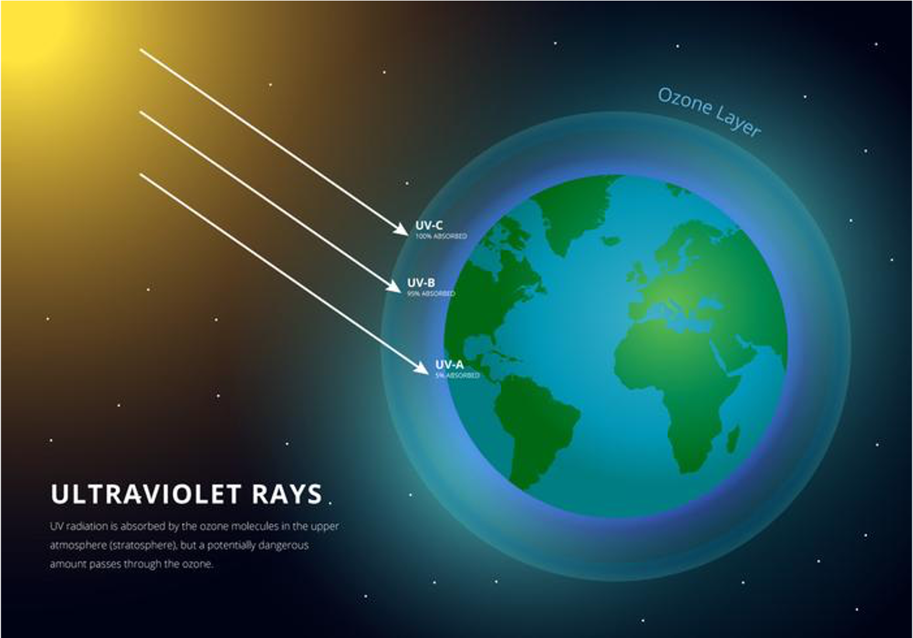{fig-align="center" width="600"}

La luz visible es solo una parte del **espectro electromagnético**. Los sensores pueden medir también infrarrojo cercano, infrarrojo de onda corta o radiación térmica. Cada banda registra un intervalo de longitudes de onda; una superficie puede responder de forma distinta en cada intervalo. Por eso una imagen con varias bandas aporta más información que una fotografía en color natural.

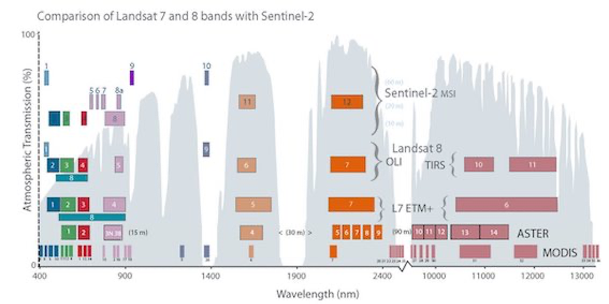{fig-align="center" width="650"}

### Cuatro resoluciones que conviene distinguir

Estas resoluciones responden preguntas distintas antes de usar una imagen como insumo para un indicador:

| Resolución | Qué describe | Pregunta para el análisis |
|---|---|---|
| **Espacial** | Tamaño de la celda en el terreno. | ¿Permite observar el objeto de interés, por ejemplo una manzana? |
| **Temporal** | Frecuencia con que el sensor puede volver a observar el lugar. | ¿Hay imágenes en las fechas o estaciones que necesitamos comparar? |
| **Espectral** | Número y amplitud de los intervalos de longitud de onda registrados. | ¿Están las bandas necesarias para distinguir el fenómeno? |
| **Radiométrica** | Niveles de intensidad que puede registrar el sensor. | ¿Con qué detalle se representan las diferencias de señal? |

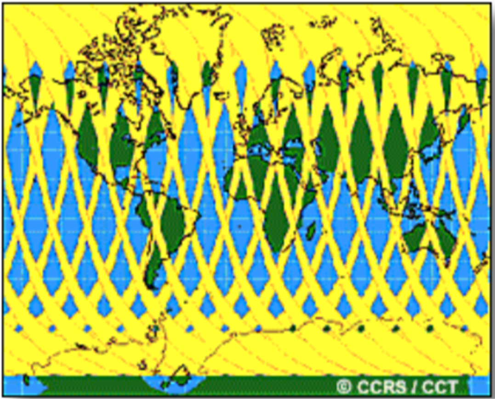{fig-align="center" width="520"}

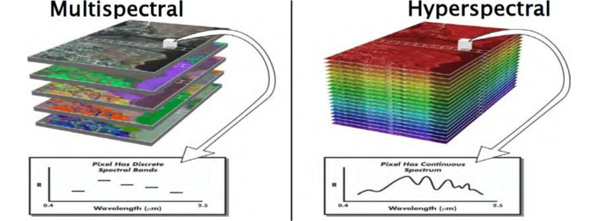{fig-align="center" width="620"}

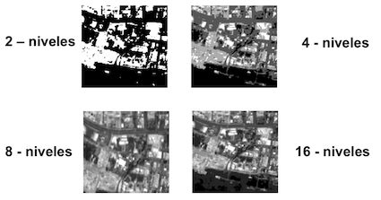{fig-align="center" width="520"}

La resolución temporal **no es la fecha de esta imagen concreta**: esa fecha debe consultarse en sus metadatos. Del mismo modo, una celda de 30 metros no garantiza que podamos reconocer árboles individuales o separar con precisión todas las coberturas de una manzana.

### De la observación a una pregunta pública

Las imágenes permiten observar fenómenos de interés público en distintos momentos. Su utilidad depende de formular primero la pregunta:

| Pregunta territorial | Qué podríamos medir con imágenes |
|---|---|
| ¿Cómo cambia la vegetación urbana? | Superficie con señal de vegetación por manzana y fecha. |
| ¿Qué extensión fue afectada por un incendio? | Área con cambios espectrales entre imágenes anteriores y posteriores. |
| ¿Dónde se expandió la ciudad? | Superficie construida en distintos años. |
| ¿Cómo varía un humedal? | Extensión de agua y vegetación en temporadas comparables. |

Para pasar de la observación a un **indicador territorial** necesitamos definir el fenómeno, el período, la unidad de análisis y la regla de cálculo. En este capítulo usaremos la vegetación por manzana como ejemplo.

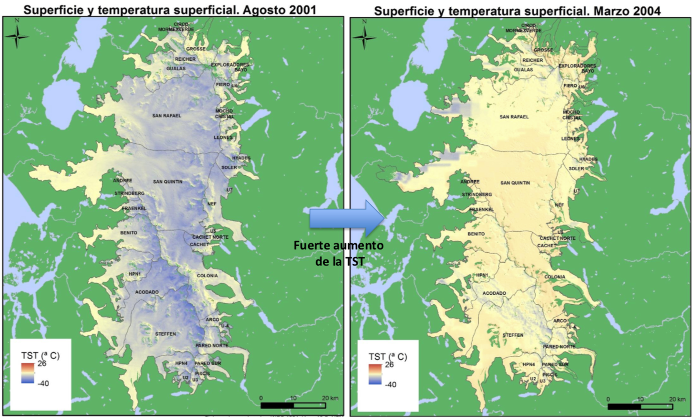{fig-align="center" width="600"}

Hay distintas misiones y lugares desde donde obtener sus datos:

| Misión | Tipo de observación | Dónde explorarla |
|---|---|---|
| [Landsat 8 y 9](https://www.usgs.gov/landsat-missions) | Bandas ópticas y térmicas. | [USGS EarthExplorer](https://earthexplorer.usgs.gov/). |
| [Sentinel-2](https://dataspace.copernicus.eu/data-collections/copernicus-sentinel-missions/sentinel-2) | Bandas ópticas multiespectrales. | [Copernicus Data Space](https://dataspace.copernicus.eu/). |
| [Sentinel-1](https://dataspace.copernicus.eu/data-collections/copernicus-sentinel-missions/sentinel-1) | Radar, útil incluso con nubosidad o sin luz solar. | [Copernicus Data Space](https://dataspace.copernicus.eu/). |

El [catálogo de Google Earth Engine](https://developers.google.com/earth-engine/datasets/catalog/) reúne muchos de estos productos y otros datos ambientales para consultarlos y procesarlos en línea. Antes de comparar fechas o calcular índices debemos identificar el producto, sus bandas, su escala y sus capas de calidad; dos archivos del mismo satélite pueden requerir tratamientos distintos.

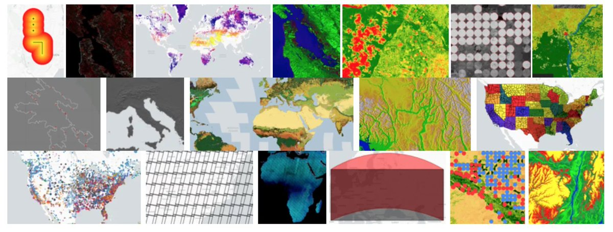{fig-align="center" width="600"}

### Leer una imagen satelital

La percepción remota registra información de la superficie sin medirla directamente en cada lugar. Los sensores a bordo de satélites producen distintas bandas que suelen distribuirse como imágenes ráster. En el ejercicio usaremos una selección de bandas asociadas a Landsat 8.

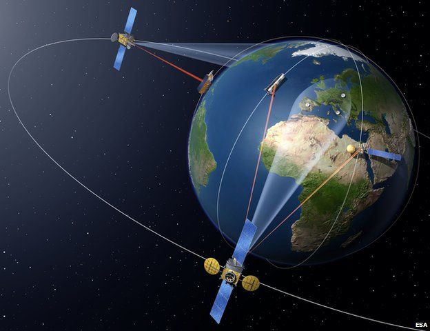{fig-align="center" width="550"}

Primero, `rast()` lee el archivo; `nlyr()` cuenta sus capas y `names()` muestra sus nombres. Este TIFF recortado trae nombres genéricos. Para saber qué representa cada posición debemos consultar la **metadata de la escena de origen** y la documentación del producto. El [catálogo de Landsat 8 Collection 2 TOA](https://developers.google.com/earth-engine/datasets/catalog/LANDSAT_LC08_C02_T1_TOA?hl=es-419) describe, por ejemplo, B4 como rojo, B5 como infrarrojo cercano y B10 como térmica. El catálogo ayuda a interpretar las bandas, pero por sí solo no confirma el procesamiento de este TIFF local.

Usaremos el orden de bandas con que se preparó el material de clase: posiciones 1 a 7 para B1 a B7 y posición 8 para la banda térmica. `names()` les asigna etiquetas legibles **después** de identificar ese orden; no lo descubre automáticamente.

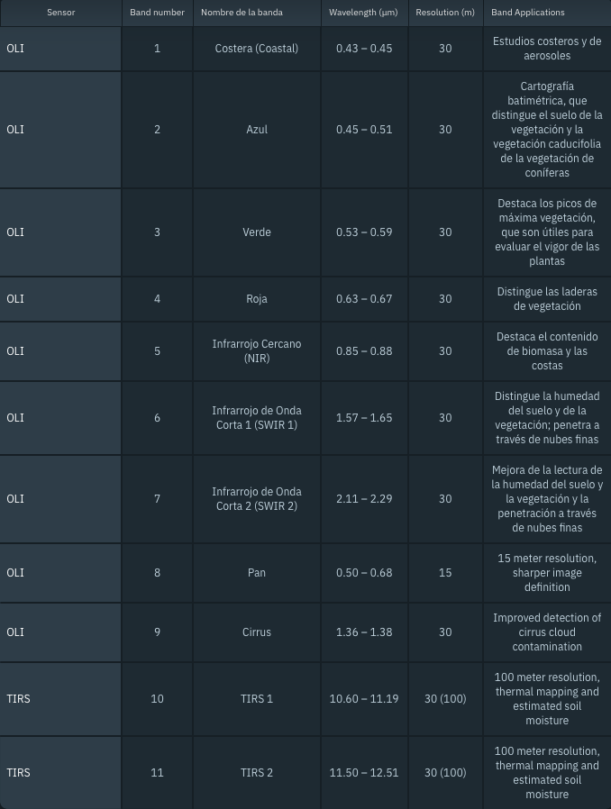{fig-align="center" width="650"}

```{r}
oli <- rast("data/raster/corte_rm_m.tif")
nlyr(oli) # Consultar cantidad de bandas (layers)
names(oli) # Consultar nombre de las bandas
```

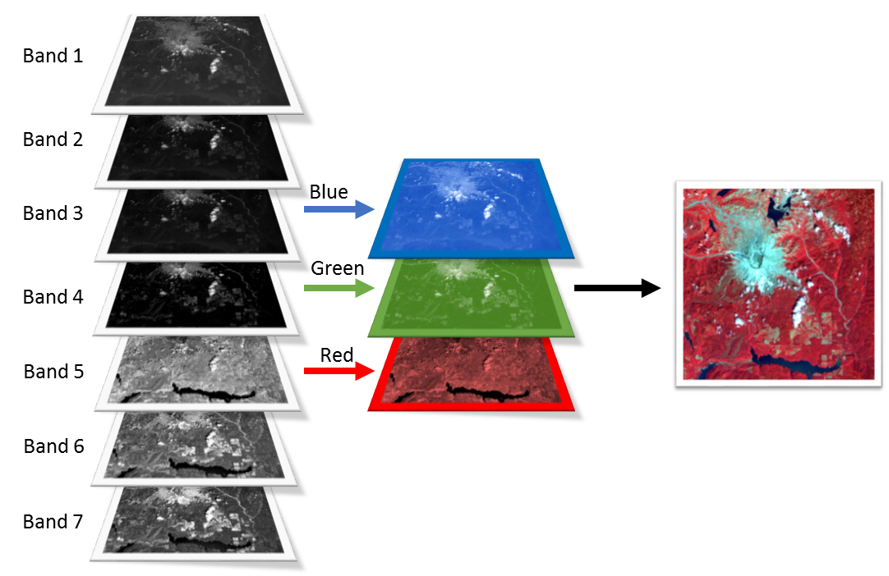{fig-align="center" width="650"}

```{r}
names(oli) <- c("aerosol", "blue", "green", "red", "nir",
                "swir1", "swir2", "thermal")
oli
```

Ahora `res()` muestra el ancho y el alto de una celda en las unidades del CRS. `crs()` devuelve el sistema de referencia; con `describe = TRUE` lo presenta de forma abreviada.

```{r}
res(oli)
crs(oli, describe = TRUE)
```

En este caso, `res(oli)` muestra celdas de 30 × 30 metros y el CRS es UTM 19 sur (`EPSG:32719`). `plotRGB()` asigna una banda al canal rojo (`r`), otra al verde (`g`) y otra al azul (`b`) de la pantalla. La composición **4–3–2** usa las bandas roja, verde y azul para mostrar una imagen cercana a la visión humana:

```{r}
plotRGB(oli, r = "red", g = "green", b = "blue", stretch = "lin")
```

La imagen cubre una zona mucho mayor que nuestra pregunta. Trabajaremos con Las Condes para reducir el área de análisis y conectar el ráster con los polígonos vistos en el capítulo anterior.

### Recortar la imagen con un polígono {#sec-cortaraster}

Leemos las comunas, elegimos Las Condes y llevamos su geometría al CRS de la imagen. `crop()` limita el rectángulo de trabajo; `mask()` deja sin valor las celdas fuera de la comuna. Son dos pasos distintos: **recortar la extensión** y **respetar el límite**.

```{r}
comuna <- st_read("data/shape/Comunas_Chile.shp", quiet = TRUE) %>%
  filter(REGION == "13", NOM_COMUNA == "LAS CONDES") %>%
  st_transform(crs(oli))

comuna_vect <- vect(comuna)
comuna_img <- crop(oli, comuna_vect, snap = "out") %>%
  mask(comuna_vect)

plotRGB(comuna_img, r = "red", g = "green", b = "blue",
        stretch = "lin", main = "Las Condes: color natural")
```

Si en otro ejercicio necesitamos reproyectar una imagen, `terra::project()` crea una cuadrícula nueva e interpola sus valores. Aquí evitamos ese cambio: transformar el polígono conserva los valores de la imagen original.

### Explorar combinaciones de bandas

Cambiar las posiciones de las bandas en `plotRGB()` cambia lo que podemos distinguir visualmente. Cada terna indica qué capa se muestra en los canales **rojo–verde–azul**, en ese orden. Por ejemplo, `5–4–3` coloca el infrarrojo cercano en rojo: la vegetación puede verse rojiza, aunque no tenga ese color en el terreno. Una composición ayuda a explorar una imagen; no reemplaza la medición ni clasifica automáticamente sus elementos.

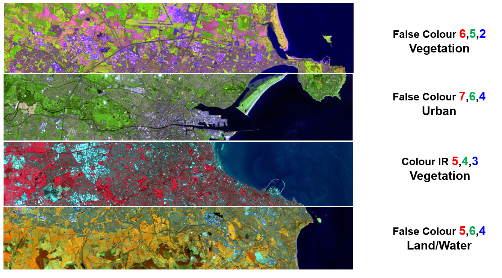{fig-align="center" width="700"}

La tabla recupera las combinaciones de la práctica. Compáralas con la imagen en color natural: observa dónde aparecen diferencias en vegetación, agua, suelo y áreas urbanizadas, sin atribuir una clase solo por el color.

| Composición | Capas en `r`, `g`, `b` | Lectura visual para discutir en clase |
|---|---|---|
| Color natural | 4–3–2 | Referencia cercana a los colores visibles. |
| Infrarrojo cercano | 5–4–3 | Destaca diferencias en la vegetación. |
| SWIR, NIR y rojo | 6–5–4 | Contrasta vegetación, suelo y zonas construidas. |
| SWIR 2, SWIR 1 y rojo | 7–6–4 | Ofrece otro contraste entre superficies. |
| SWIR 1, NIR y azul | 6–5–2 | Permite comparar vegetación, humedad y suelo. |
| SWIR 2, SWIR 1 y NIR | 7–6–5 | Cambia el contraste de superficies con distinta respuesta infrarroja. |
| NIR, SWIR 1 y rojo | 5–6–4 | Facilita comparar vegetación con otras coberturas. |
| SWIR 2, NIR y rojo | 7–5–4 | Muestra otra combinación para explorar coberturas. |
| NIR, SWIR 1 y azul | 5–6–2 | Ofrece otro contraste para observar la vegetación. |

**4–3–2: color natural.** Ya lo vimos arriba. Ahora probemos las otras ocho ternas sobre la misma comuna, manteniendo el mismo ajuste visual (`stretch = "lin"`) para concentrarnos en el efecto de cambiar las bandas.

**5–4–3: infrarrojo cercano.** Observa cómo cambia la apariencia de las zonas con vegetación.

```{r}
plotRGB(comuna_img, r = 5, g = 4, b = 3, stretch = "lin",
        main = "5–4–3: infrarrojo cercano")
```

**6–5–4: SWIR, infrarrojo cercano y rojo.** Compárala con la anterior: ahora la banda SWIR ocupa el canal rojo.

```{r}
plotRGB(comuna_img, r = 6, g = 5, b = 4, stretch = "lin",
        main = "6–5–4: SWIR, NIR y rojo")
```

**7–6–4: dos bandas SWIR y rojo.** Fíjate en cómo cambia el contraste de las superficies.

```{r}
plotRGB(comuna_img, r = 7, g = 6, b = 4, stretch = "lin",
        main = "7–6–4: SWIR 2, SWIR 1 y rojo")
```

**6–5–2: SWIR, infrarrojo cercano y azul.** Observa las diferencias con el color natural.

```{r}
plotRGB(comuna_img, r = 6, g = 5, b = 2, stretch = "lin",
        main = "6–5–2: SWIR 1, NIR y azul")
```

**7–6–5: tres bandas infrarrojas.** Aquí no usamos bandas visibles; los colores son una traducción de mediciones fuera de la visión humana.

```{r}
plotRGB(comuna_img, r = 7, g = 6, b = 5, stretch = "lin",
        main = "7–6–5: bandas infrarrojas")
```

**5–6–4: infrarrojo cercano, SWIR y rojo.** Compara la vegetación con las áreas construidas.

```{r}
plotRGB(comuna_img, r = 5, g = 6, b = 4, stretch = "lin",
        main = "5–6–4: NIR, SWIR 1 y rojo")
```

**7–5–4: SWIR, infrarrojo cercano y rojo.** Cambia solo la primera banda respecto de la composición anterior: ¿qué diferencias ves?

```{r}
plotRGB(comuna_img, r = 7, g = 5, b = 4, stretch = "lin",
        main = "7–5–4: SWIR 2, NIR y rojo")
```

**5–6–2: infrarrojo cercano, SWIR y azul.** Compárala con 5–6–4: solo cambió la banda asignada al canal azul.

```{r}
plotRGB(comuna_img, r = 5, g = 6, b = 2, stretch = "lin",
        main = "5–6–2: NIR, SWIR 1 y azul")
```

En esta práctica las posiciones 1 a 7 corresponden a las bandas B1 a B7 del material preparado. **No hay que trasladar esos números sin comprobarlos a otro archivo**: una imagen puede incluir, excluir o reordenar bandas. Para interpretar por qué cambian los colores, consulta también la [guía de NASA sobre imágenes en falso color](https://science.nasa.gov/earth/earth-observatory/how-to-interpret-a-false-color-satellite-image/).

## Caso aplicado: vegetación por manzana

Pasaremos por tres niveles: **bandas satelitales → índice por celda → superficie por manzana**. El resultado será el porcentaje de la superficie de cada manzana que el ejercicio clasifica como vegetada.

### Calcular el NDVI {#sec-calcndvi}

El **Índice de Vegetación de Diferencia Normalizada (NDVI)** compara la banda del infrarrojo cercano (NIR) con la roja. La vegetación fotosintéticamente activa suele reflejar más en NIR que en rojo. El índice se calcula en cada celda:

$$
NDVI = \frac{NIR - Rojo}{NIR + Rojo}
$$

Sus valores suelen situarse entre −1 y 1. Los valores altos son compatibles con vegetación activa, pero **NDVI no identifica por sí solo una especie, el estado de un árbol ni la calidad de un área verde**.

```{r}
rojo <- comuna_img[["red"]]
infrarrojo <- comuna_img[["nir"]]
ndvi <- (infrarrojo - rojo) / (infrarrojo + rojo)
names(ndvi) <- "NDVI"

plot(ndvi, main = "NDVI: Las Condes")
```

Para ver cómo se distribuyen los valores, convertimos la capa NDVI en una tabla de celdas válidas y dibujamos un histograma con `ggplot2`. Cada barra cuenta celdas dentro de un rango de NDVI; no representa manzanas ni habitantes.

```{r}
ndvi_valores <- as.data.frame(ndvi, na.rm = TRUE)

ggplot(ndvi_valores, aes(x = NDVI)) +
  geom_histogram(bins = 40, fill = "seagreen3", color = "white") +
  labs(title = "Distribución del NDVI en Las Condes",
       x = "NDVI", y = "Número de celdas") +
  theme_minimal()
```

::: {.callout-important}
## Antes de interpretar el índice

El catálogo citado describe un producto Landsat 8 de reflectancia TOA, pero este TIFF de clase no conserva información suficiente para confirmar que provenga de ese producto, cuándo se capturó ni cómo se trataron las nubes y sombras. Tampoco podemos saber aquí si sus valores ya fueron convertidos a reflectancia. Por eso, el cálculo siguiente **demuestra el método**, pero sus cifras no deben presentarse como una estimación validada de cobertura vegetal. Para un uso real, revisa primero la metadata de la escena de origen y aplica solo las conversiones que correspondan a ese producto.
:::

### Definir una regla de clasificación {#sec-umbralicv}

Para practicar, marcaremos con `1` las celdas cuyo índice sea al menos `0.20` y con `0` las demás. El umbral es **exploratorio**: no es una definición universal de vegetación. Las celdas sin dato seguirán como `NA`, para no confundir ausencia de información con ausencia de vegetación.

```{r}
umbral <- 0.20
vegetacion <- ifel(is.na(ndvi), NA, ifel(ndvi >= umbral, 1, 0))
names(vegetacion) <- "sobre_umbral"

plot(vegetacion, main = "Celdas sobre el umbral de NDVI")
```

### Resumir por manzana {#sec-calcicv}

La unidad de análisis ahora es una manzana censal. Queremos saber **qué porcentaje de su superficie quedó clasificado como vegetación**. Para ello, primero estimamos el área vegetada y luego la dividimos por el área total de la manzana.

El ráster `vegetacion` vale `1` en las celdas sobre el umbral de NDVI y `0` en las demás. Al usar `exact_extract(vegetacion, ..., "sum")`, una celda con valor `1` aporta según la parte que cae dentro de la manzana: si entra completa, aporta `1`; si entra solo la mitad, aporta `0,5`. Una celda con valor `0` no aporta al área vegetada. Por eso `pix_veg` puede tener decimales: representa una cantidad de **celdas completas equivalentes**, considerando también las celdas del borde.

En este ejercicio, las celdas miden 30 × 30 metros en un CRS cuyas unidades son metros. Cada celda completa ocupa, entonces, **900 m²**. Multiplicamos `pix_veg` por esa superficie para obtener `area_veg`: media celda clasificada como vegetación, por ejemplo, representa 450 m² dentro de la manzana. La fórmula del indicador es:

$$
ICV = \frac{\text{pix\_veg} \times 30 \times 30}{\text{AREA}} \times 100
$$

Primero leemos las manzanas, las llevamos al mismo CRS del ráster y calculamos su área total en metros cuadrados con `st_area()`. Antes de usar 30 × 30 en el cálculo, comprobamos el tamaño de celda con `res(vegetacion)`. Si trabajáramos con otro ráster, tendríamos que usar su resolución y verificar que sus unidades sean metros.

```{r}
library(exactextractr)

manzanas <- readRDS("data/censo/manzanas.rds") %>%
  filter(NOM_COM == "LAS CONDES") %>%
  st_transform(crs(oli)) %>%
  mutate(AREA = as.numeric(st_area(.)))

res(vegetacion)
```

Con esos datos, hacemos tres operaciones: sumamos las celdas clasificadas como vegetación dentro de cada manzana (`pix_veg`), convertimos esa suma a metros cuadrados (`area_veg`) y calculamos qué porcentaje representa del área total (`ICV`).

```{r}
manzanas <- manzanas %>%
  mutate(pix_veg = exact_extract(vegetacion, ., "sum", progress = FALSE),
         area_veg = pix_veg * 30 * 30,
         ICV = round(area_veg / AREA * 100, 1))

manzanas %>%
  st_drop_geometry() %>%
  select(AREA, pix_veg, area_veg, ICV) %>%
  head()
```

El **ICV** indica qué porcentaje del área total de la manzana quedó sobre el umbral de NDVI elegido. En este ejemplo contamos con datos para toda la superficie analizada. Si una imagen tuviera zonas sin datos, habría que revisarlas antes de interpretar el porcentaje: no sabemos si allí había vegetación.

```{r}
ggplot(manzanas) +
  geom_sf(aes(fill = ICV), color = NA) +
  scale_fill_distiller(palette = "Greens", direction = 1,
                       na.value = "grey85", name = "% de manzana") +
  labs(title = "Las Condes: superficie sobre el umbral de NDVI por manzana",
       subtitle = "Ejercicio exploratorio; no equivale a cobertura vegetal validada") +
  theme_minimal()
```

### Leer el resultado como indicador territorial

Si una manzana tiene un ICV de 40, estimamos que la superficie clasificada como vegetación equivale al **40 % de su área total**. Este porcentaje incluye vegetación en terrenos públicos y privados y permite describir una condición ambiental de la manzana: su cobertura vegetal.

Cada celda de la imagen representa 30 × 30 metros. En una manzana pequeña pueden caber pocas celdas, de modo que clasificar una sola como vegetación puede cambiar bastante el porcentaje. Aunque el cálculo considera solo la parte de cada celda que cae dentro de la manzana, no permite saber exactamente dónde está la vegetación dentro de esa celda. Por eso, el ICV es una **estimación** de cobertura vegetal, especialmente en manzanas pequeñas.

Antes de comparar manzanas o años en una política pública, conviene dejar registrados la fecha y el producto de la imagen, el tratamiento de nubes, la conversión de valores digitales, el umbral, las zonas sin datos y la versión de los límites censales. La estación del año también puede cambiar el NDVI, por lo que las comparaciones requieren imágenes tomadas en períodos similares.

La idea central es transferible a otros temas: una medida por celda puede resumirse dentro de polígonos, siempre que el significado de los valores y la calidad de la observación acompañen al número final.

## Referencias

-   [Documentación de `terra`](https://rspatial.github.io/terra/): lectura, operación y visualización de datos ráster.
-   [`app()`, `lapp()` y `classify()` en `terra`](https://rspatial.github.io/terra/reference/terra-package.html): funciones para operar y reclasificar celdas.
-   [Documentación de `exactextractr`](https://isciences.gitlab.io/exactextractr/): resúmenes de ráster dentro de polígonos considerando celdas de borde.
-   [Planos de evacuación de SENAPRED](https://www.senapred.cl/planos-de-evacuacion/): áreas, rutas y puntos de encuentro oficiales.
-   [Catálogo de Landsat 8 Collection 2 TOA en Earth Engine](https://developers.google.com/earth-engine/datasets/catalog/LANDSAT_LC08_C02_T1_TOA?hl=es-419): descripción de bandas y propiedades del producto.
-   [NASA: cómo interpretar imágenes en falso color](https://science.nasa.gov/earth/earth-observatory/how-to-interpret-a-false-color-satellite-image/).
-   [USGS: factores de escala en productos Landsat Level-2](https://www.usgs.gov/faqs/how-do-i-use-a-scale-factor-landsat-level-2-science-products): ejemplo de por qué debe verificarse el producto antes de convertir sus valores.
