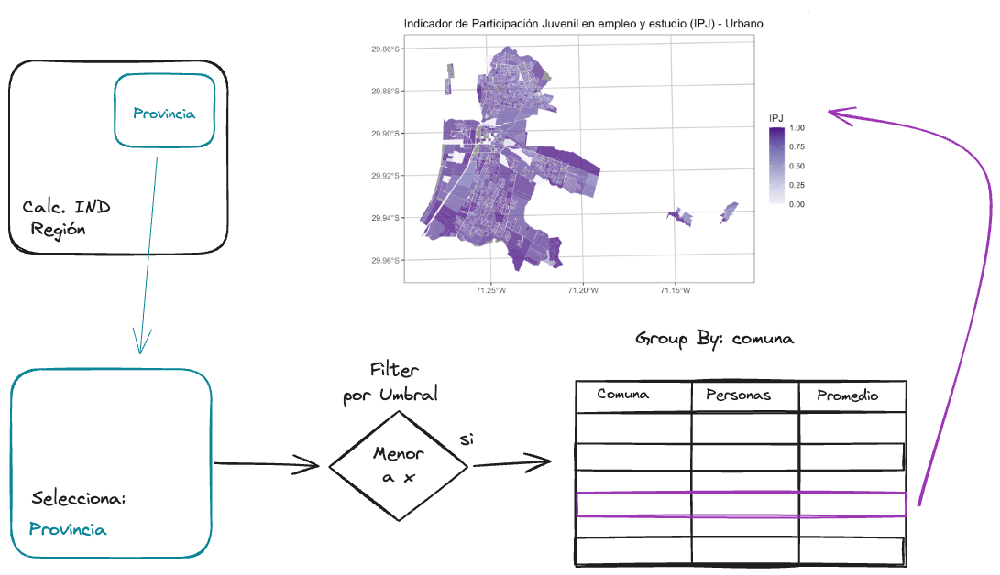

# Tarea 1 {.unnumbered}

## Antecedentes

- Publicación: **17 de octubre de 2026**.
- Entrega: **27 de octubre de 2026**.
- Modalidad: **individual**.
- Ponderación: **40 % de la nota final**.
- Formato: **informe** (PDF, PPTX, Markdown o HTML) **y código**. Incluye los mapas, la tabla, una breve explicación de tus decisiones y la interpretación de los resultados.

## Parte 1: vegetación urbana (3 puntos)

Elige una comuna de la Región Metropolitana **distinta de Las Condes**. Usa una imagen que cubra la comuna.

1. **NDVI (1 punto).** Recorta la imagen al límite comunal (@sec-cortaraster) y calcula el NDVI (@sec-calcndvi). Presenta un mapa.

2. **Vegetación (1 punto).** Elige y justifica un umbral de NDVI para clasificar la vegetación (@sec-umbralicv). Informa la superficie clasificada como vegetación dentro de la comuna y presenta un mapa.

3. **Cobertura por manzana (1 punto).** Calcula el porcentaje de superficie clasificada como vegetación en cada manzana urbana de la comuna (@sec-calcicv). Presenta un mapa y describe dónde hay valores altos y bajos.

Indica la fuente y fecha de la imagen, si se conocen, y las limitaciones del resultado. Si utilizas la imagen de clase del libro, presenta los cálculos como **exploratorios**, según se explica en @sec-calcndvi.

## Parte 2: indicadores socioeconómicos (3 puntos)

Elige una región y usa sus manzanas urbanas. El procedimiento y las definiciones están en @sec-indsoc.

1. **Indicadores (1 punto).** Calcula **IEM, IVI, ISV, IEA e IRH** y la Dimensión Socioeconómica para las manzanas urbanas de la región escogida. Presenta los resultados en una tabla como se hizo en @sec-resSoc.

2. **Resumen provincial (1 punto).** Elige una provincia y uno de estos indicadores para analizar una necesidad: **IEM, IVI, ISV o IEA**. Define y justifica un umbral crítico. Para cada comuna de la provincia, usa `group_by()` (@sec-groupby) y muestra:

   - el número de habitantes de las **manzanas** cuyo indicador está bajo el umbral;
   - el promedio del indicador entre las manzanas urbanas de la comuna.

   El conteo se refiere a habitantes de esas manzanas; no significa que cada persona tenga la condición medida por el indicador.

3. **Mapa comunal (1 punto).** Elige la comuna con más habitantes en manzanas bajo el umbral **o** con el menor promedio del indicador. Justifica tu elección, haz un mapa del indicador por manzana y describe dónde se concentran sus valores altos y bajos.

