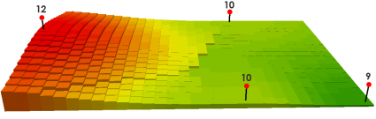
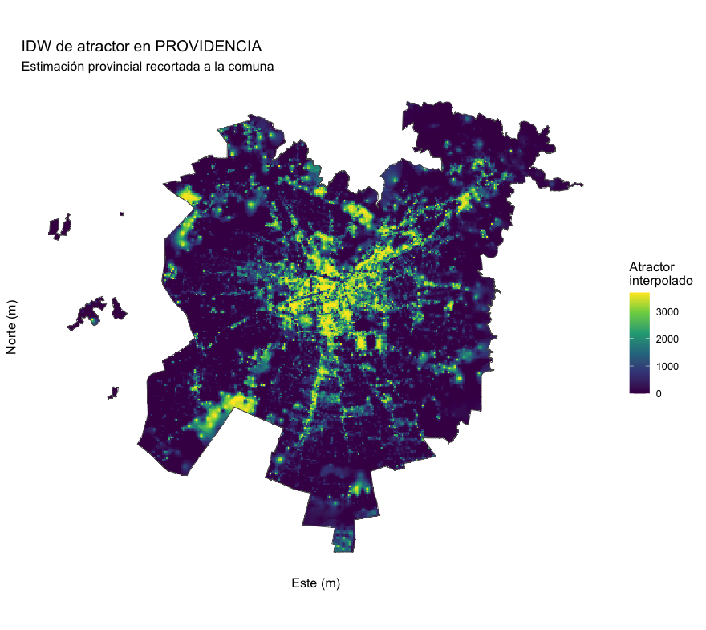
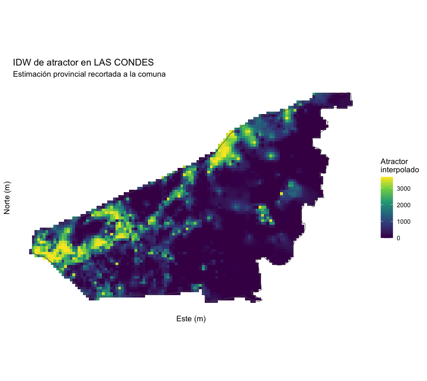
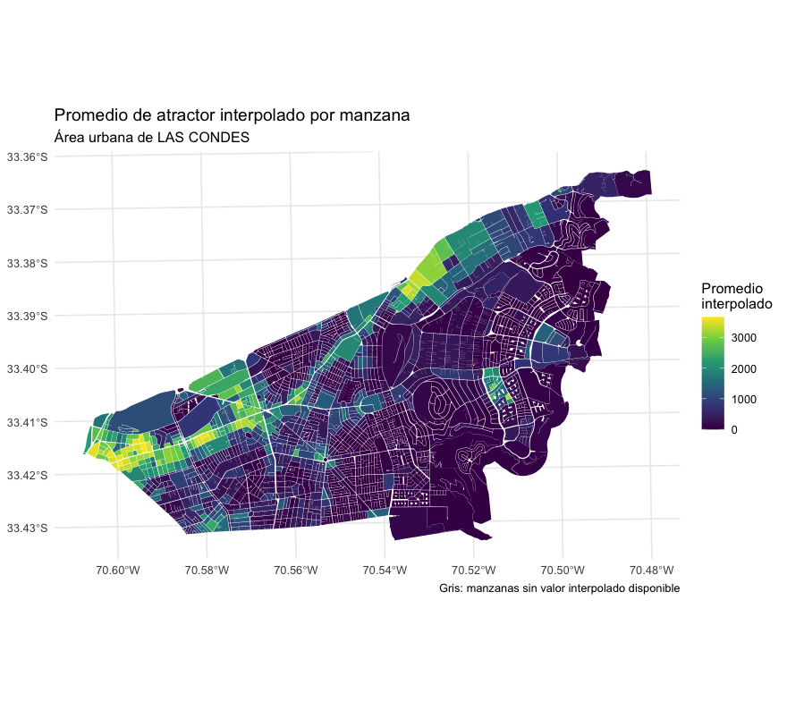
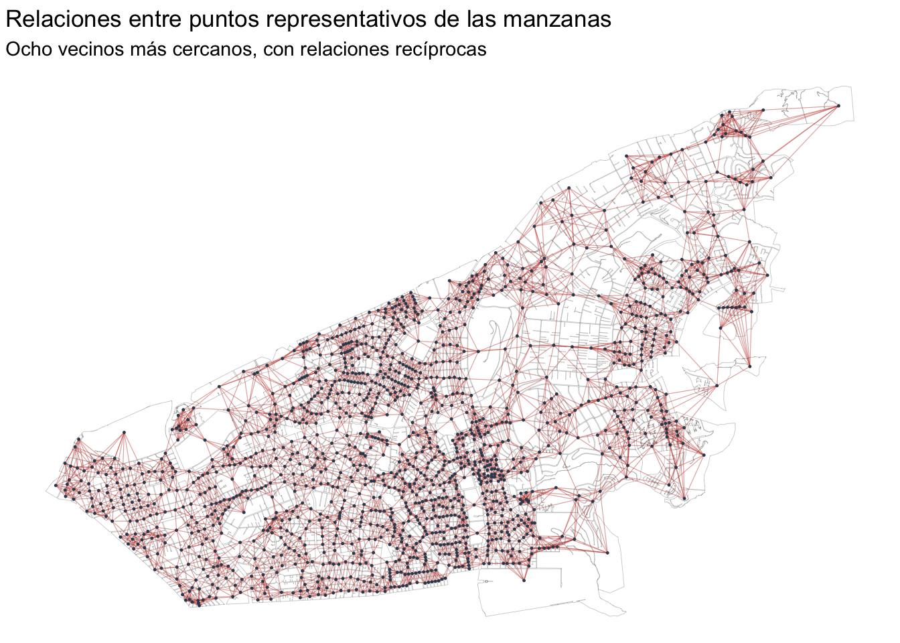
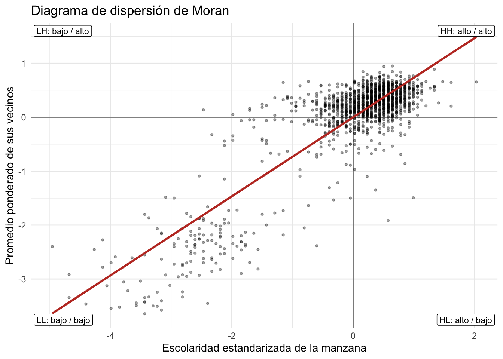
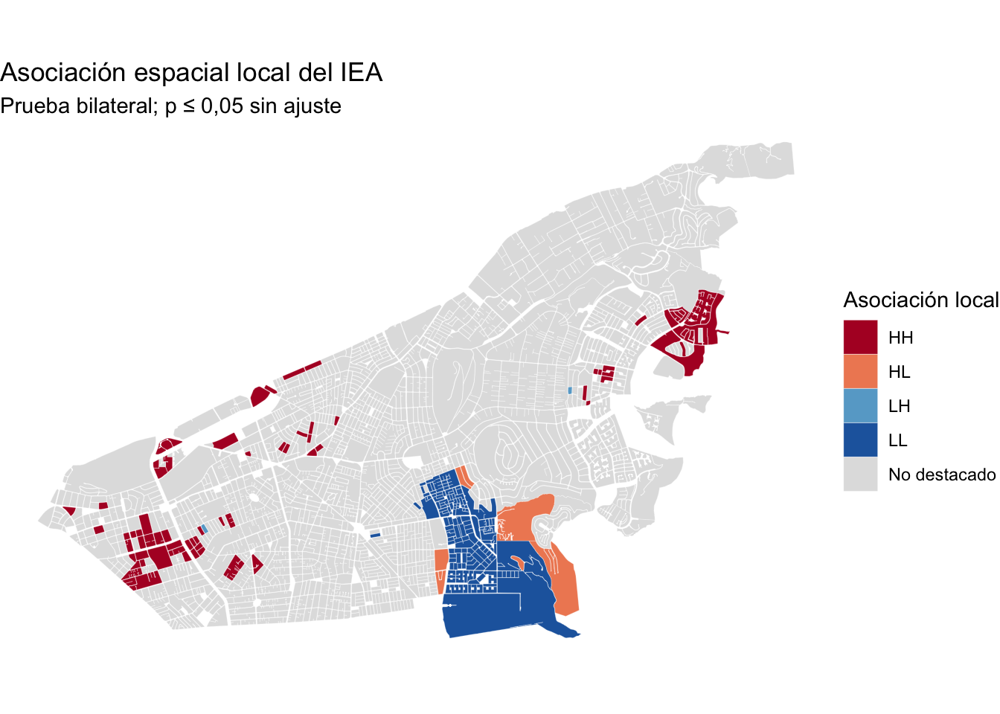

# Tarea 2 {.unnumbered}

## Antecedentes

- **Publicación:** 27 de octubre de 2026.
- **Entrega:** 8 de noviembre de 2026.
- **Modalidad:** individual.
- **Ponderación:** 60 % de la nota final.
- **Formato:** un informe en PDF, PPTX, Markdown o HTML, acompañado del código utilizado. El informe debe contener mapas legibles, tablas de resultados, decisiones metodológicas e interpretación.
- **Atraso:** se descontarán 0,5 puntos por cada 12 horas de retraso.

## Parte 1: interpolación inversa a la distancia (3 puntos)

La IDW estima valores entre puntos observados dando más peso a los puntos cercanos. Revisa la explicación del método en @sec-IDW. La imagen siguiente ilustra la idea general; **no representa los datos de esta tarea**.

<!--  -->

1. **Prepara el ámbito provincial y revisa los datos.** Define el área urbana de la **provincia de Santiago** con `data/censo/zonas_urb_consolidadas.rds` y selecciona **todos** los puntos de `data/sii/urbes.shp` que caen en ella, sin filtrar todavía por comuna. Comprueba que puntos y límite coincidan espacialmente y trabajen en un sistema de coordenadas proyectadas en metros. Informa cuántos puntos usarás. Examina valores faltantes, ceros y extremos de `comercio`, `oficinas` y `atractor`; si modificas algún valor extremo (método windsorizacion), deja claro que ya no interpolas los datos originales.

2. **Calcula tres superficies IDW provinciales (1,5 puntos).** Interpola por separado los campos **`comercio`**, **`oficinas`** y **`atractor`** usando los puntos del área urbana provincial. Usa una grilla provincial común para las tres superficies. Informa la resolución de celda en metros, la potencia de IDW y el máximo de vecinos empleados.

3. **Elige la comuna y construye tres indicadores por manzana (1,5 puntos).** Después de calcular las tres IDW provinciales, elige una comuna urbana de la provincia (`data/censo-2024/censo_2024_nacional.gpkg`). Recorta el raster de IDW provincial por el límite comunal. Calcula cada indicador por las manzanas mediante una estadística zonal que elijas, por ejemplo el promedio (`exact_extract`). Presenta **un mapa de la IDW recortada y un mapa del indicador por cada variable**. Describe dónde aparecen valores altos y bajos y en qué difieren las superficies. Para las variables numéricas usa paletas continuas.

::: {#fig-w layout-ncol="2"}

Pasar de IDW comunal a Indicador Tererritorial
:::

**Interpretación necesaria:** estos indicadores resumen valores **interpolados**, no mediciones directas dentro de cada manzana. La hipótesis es que estos actractores de comercio y oficina pueden polos de atracción de población flotante.

## Parte 2: autocorrelación espacial (3 puntos)

Trabaja con las manzanas urbanas del Censo 2024 disponibles en `results/R13_Santiago_urbano_ind_socioeconomicos_2024.rds`. Revisa los conceptos de vecindad, Moran global y Moran local en @sec-matrizVec, @sec-globalMoran y @sec-localMoran.

1. **Selecciona la variable y plantea una hipótesis (0,5 puntos).** Elige una comuna urbana distinta de Las Condes y un indicador disponible en la base, por ejemplo `IEA`, `ISV` o `IVI`. Indica qué mide y en qué dirección se interpreta; no supongas que un valor alto significa siempre mayor necesidad. Muestra su distribución y un mapa inicial. Excluye valores faltantes y unidades sin población **antes** de construir la vecindad, e informa cuántas manzanas quedaron.

2. **Construye los pesos espaciales (0,5 puntos).** Parte de los ocho vecinos más próximos de cada manzana y convierte las relaciones en recíprocas, como se explica en el capítulo. Dentro de esa vecindad, asigna a cada vecino un peso proporcional a su población `n_per` y normaliza los pesos de cada manzana para que sumen uno. Informa el criterio de vecindad, el número de unidades y el rango de cantidad de vecinos. Explica qué cambia al ponderar por población: **no cambia quién es vecino, sino cuánto influye cada vecino**.

3. **Evalúa Moran global (1 punto).** Calcula el índice y una prueba con 999 permutaciones usando los pesos anteriores. Presenta el estadístico, el valor p y un diagrama de dispersión de Moran con sus cuadrantes. Explica qué indican el signo del índice, la prueba y los cuadrantes para la comuna estudiada. Un resultado global no localiza por sí solo los sectores destacados.

4. **Evalúa Moran local (1 punto).** Calcula el índice por manzana con la misma variable y los mismos pesos. Usa un umbral de valor p **≤ 0,05** e identifica HH, LL, HL, LH y las unidades no destacadas. Los cuadrantes dependen del valor de la manzana y del promedio ponderado de sus vecinos; el valor p decide si se destaca la asociación local. Presenta un mapa con colores categóricos y una tabla con el número de manzanas en cada categoría. Interpreta al menos un patrón relevante para una pregunta de política pública e indica una limitación de los datos o de las múltiples pruebas locales.

**Al cerrar el informe**, distingue lo que muestran los mapas de lo que todavía habría que comprobar con otras fuentes antes de recomendar una intervención.
